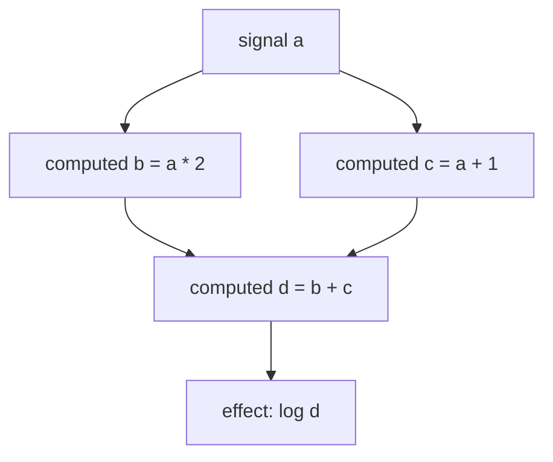
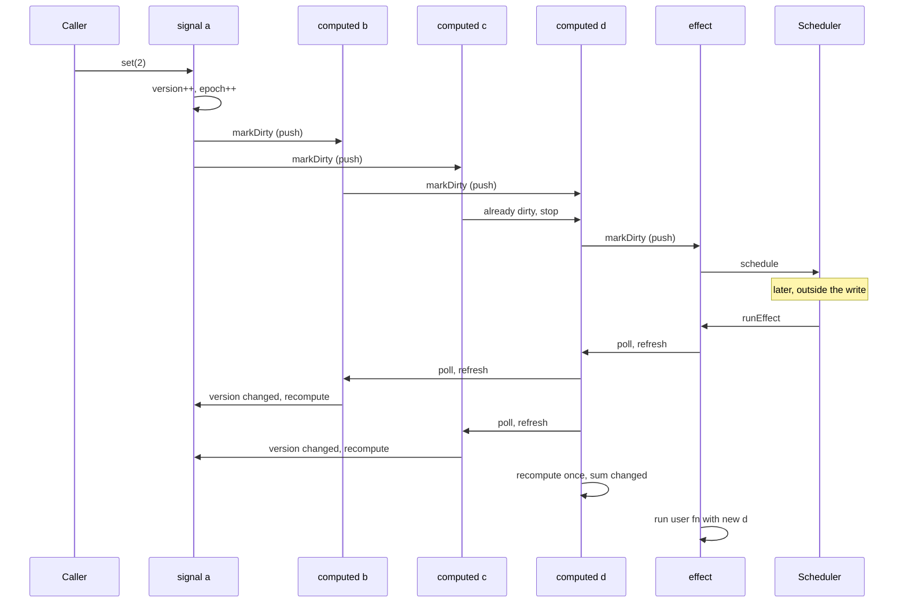
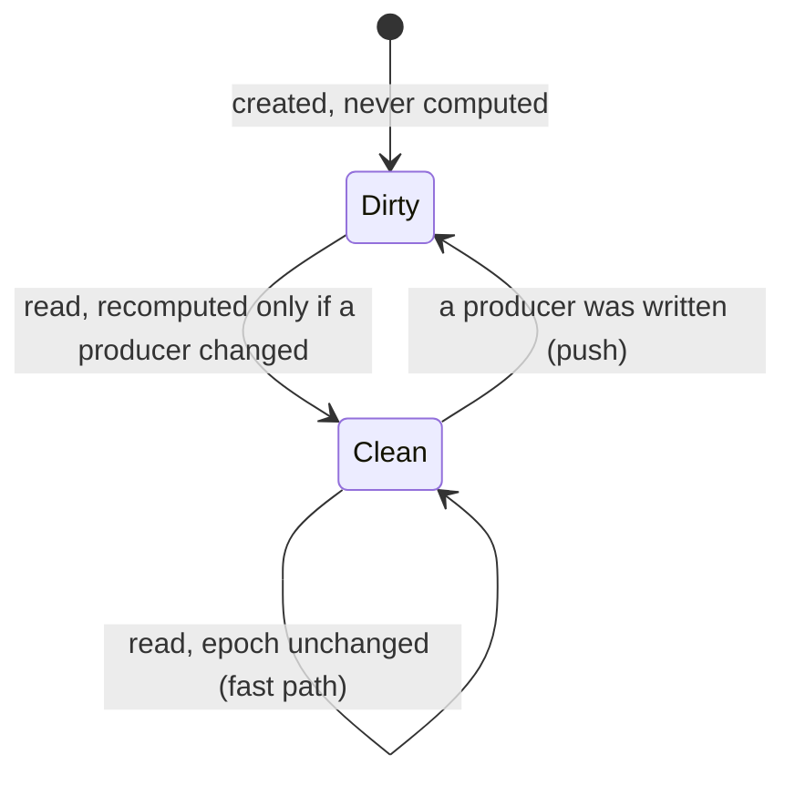
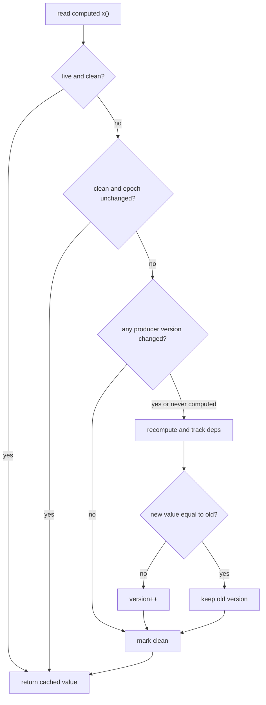
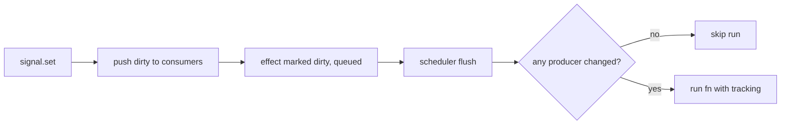

<!-- Generated by SpecStory, Markdown v2.1.0 -->

# 2026-11-05 10:48:45Z

<!-- VS Code Copilot IDE Session 09c103a5-990e-4861-b1f1-d7b41dfe0386 (2026-11-05 10:48:45Z) -->

_**User (2026-11-05 10:48:45Z)**_

create clear pseudo code + comments intuitive explanation of internal workings of signals + mermaid diagrams if usefull
save to new md file in docs

---

_**Agent (copilot/claude-haiku-5.5)**_

I'll check the signal implementation in the installed `@angular/core` so the doc matches the actual code. 

_**Agent (copilot/claude-haiku-5.5)**_

<tool-use data-tool-type="search" data-tool-name="grep_search"><details>
<summary>Tool use: **grep_search**</summary>

No matches found. Your search pattern might be excluded completely by either the search.exclude settings or .*ignore files.
If you believe that it should have results, you can check into the .*ignore files and the exclude setting (here are some excluded patterns for reference:[**/node_modules,**/bower_components,**/*.code-search]).
Then if you want to include those files you can call the tool again by setting "includeIgnoredFiles" to true.

**Input:**

- includePattern: `node_modules/@angular/core/fesm2022/**`
- isRegexp: `true`
- maxResults: `50`
- query: `function producerNotifyConsumers|function consumerPollProducersForChange|function producerUpdateValueVersion|function signalSetFn|function producerAccessed|function consumerMarkDirty|function producerIncrementEpoch|function consumerBeforeComputation|function consumerAfterComputation|function producerRemoveLiveConsumerAtIndex|function producerAddLiveConsumer`
</details></tool-use>

_**Agent (copilot/claude-haiku-5.5)**_

<tool-use data-tool-type="search" data-tool-name="grep_search"><details>
<summary>Tool use: **grep_search**</summary>

Searched for text `function producerNotifyConsumers` (`**/node_modules/@angular/core/**`), 3 results

**Input:**

- includeIgnoredFiles: `true`
- includePattern: `node_modules/@angular/core/**`
- isRegexp: `false`
- maxResults: `20`
- query: `function producerNotifyConsumers`

**Result:**

```
Found 3 matches in 3 files for "function producerNotifyConsumers"

node_modules/@angular/core/fesm2022/_effect-chunk.mjs
108:function producerNotifyConsumers(node) {

node_modules/@angular/core/fesm2022/_effect-chunk.mjs.map
1:lue, we're no longer dirty.\n  producerMarkClean(node);\n}\n\n/**\n * Propagate a dirty notification to live consumers of this producer.\n */\nexport function producerNotifyConsumers(node: ReactiveNode): void {\n  if (node.consumers === undefined) {\n    return;\n  }\n\n  // Prevent sig [match at col 12381 · line truncated, 44,671 chars]

node_modules/@angular/core/types/_formatter-chunk.d.ts
154:declare function producerNotifyConsumers(node: ReactiveNode): void;
```
</details></tool-use>

_**Agent (copilot/claude-haiku-5.5)**_

<tool-use data-tool-type="search" data-tool-name="grep_search"><details>
<summary>Tool use: **grep_search**</summary>

Searched for regex `^function |^let |^const |^export function ` (`**/node_modules/@angular/core/fesm2022/_effect-chunk.mjs`), 49 results

**Input:**

- includeIgnoredFiles: `true`
- includePattern: `node_modules/@angular/core/fesm2022/_effect-chunk.mjs`
- isRegexp: `true`
- maxResults: `80`
- query: `^function |^let |^const |^export function `

**Result:**

```
Found 49 matches in 1 file for "^function |^let |^const |^export function "

node_modules/@angular/core/fesm2022/_effect-chunk.mjs
7:const activeConsumer = [null];
8:const inNotificationPhase = [false];
9:let epoch = 1;
10:let postProducerCreatedFn = null;
11:const SIGNAL = /* @__PURE__ */Symbol('SIGNAL');
12:function setActiveConsumer(consumer) {
17:function getActiveConsumer() {
20:function isInNotificationPhase() {
23:function isReactive(value) {
26:const REACTIVE_NODE = {
43:function producerAccessed(node) {
91:function producerIncrementEpoch() {
94:function producerUpdateValueVersion(node) {
108:function producerNotifyConsumers(node) {
125:function producerUpdatesAllowed() {
128:function consumerMarkDirty(node) {
133:function producerMarkClean(node) {
137:function consumerBeforeComputation(node) {
141:function resetConsumerBeforeComputation(node) {
152:function consumerAfterComputation(node, prevConsumer) {
156:function finalizeConsumerAfterComputation(node) {
173:function consumerPollProducersForChange(node) {
187:function consumerDestroy(node) {
199:function producerAddLiveConsumer(node, link) {
217:function producerRemoveLiveConsumerLink(link) {
242:function consumerIsLive(node) {
245:function runPostProducerCreatedFn(node) {
248:function setPostProducerCreatedFn(fn) {
254:function defaultEquals(a, b) {
258:function createComputed(computation, equal) {
279:const UNSET = /* @__PURE__ */Symbol('UNSET');
280:const COMPUTING = /* @__PURE__ */Symbol('COMPUTING');
281:const ERRORED = /* @__PURE__ */Symbol('ERRORED');
282:const COMPUTED_NODE = /* @__PURE__ */(() => {
322:function defaultThrowError() {
325:let throwInvalidWriteToSignalErrorFn = defaultThrowError;
326:function throwInvalidWriteToSignalError(node) {
329:function setThrowInvalidWriteToSignalError(fn) {
333:let postSignalSetFn = null;
334:function createSignal(initialValue, equal) {
350:function setPostSignalSetFn(fn) {
355:function signalGetFn(node) {
359:function signalSetFn(node, newValue) {
368:func
… (output truncated)
```
</details></tool-use>

_**Agent (copilot/claude-haiku-5.5)**_

<tool-use data-tool-type="read" data-tool-name="read_file"><details>
<summary>Tool use: **read_file**</summary>

Read `_effect-chunk.mjs`

**Input:**

- endLine: `420`
- filePath: `c:\Projects\sages-angular-adv-1126\node_modules\@angular\core\fesm2022\_effect-chunk.mjs`
- startLine: `1`

**Result:**

```
/**
 * @license Angular v22.2.4
 * (c) 2010-2026 Google LLC. https://angular.dev/
 * License: MIT
 */

const activeConsumer = [null];
const inNotificationPhase = [false];
let epoch = 1;
let postProducerCreatedFn = null;
const SIGNAL = /* @__PURE__ */Symbol('SIGNAL');
function setActiveConsumer(consumer) {
  const prev = activeConsumer[0];
  activeConsumer[0] = consumer;
  return prev;
}
function getActiveConsumer() {
  return activeConsumer[0];
}
function isInNotificationPhase() {
  return inNotificationPhase[0];
}
function isReactive(value) {
  return value[SIGNAL] !== undefined;
}
const REACTIVE_NODE = {
  version: 0,
  lastCleanEpoch: 0,
  dirty: false,
  producers: undefined,
  producersTail: undefined,
  consumers: undefined,
  consumersTail: undefined,
  recomputing: false,
  consumerAllowSignalWrites: false,
  consumerIsAlwaysLive: false,
  kind: 'unknown',
  producerMustRecompute: () => false,
  producerRecomputeValue: () => {},
  consumerMarkedDirty: () => {},
  consumerOnSignalRead: () => {}
};
function producerAccessed(node) {
  if (inNotificationPhase[0]) {
    throw new Error(typeof ngDevMode !== 'undefined' && ngDevMode ? `Assertion error: signal read during notification phase` : '');
  }
  const consumer = activeConsumer[0];
  if (consumer === null) {
    return;
  }
  consumer.consumerOnSignalRead(node);
  const prevProducerLink = consumer.producersTail;
  if (prevProducerLink !== undefined && prevProducerLink.producer === node) {
    return;
  }
  let nextProducerLink = undefined;
  const isRecomputing = consumer.recomputing;
  if (isRecomputing) {
    nextProducerLink = prevProducerLink !== undefined ? prevProducerLink.nextProducer : consumer.producers;
    if (nextProducerLink !== undefined && nextProducerLink.producer === node) {
      consumer.producersTail = nextProducerLink;
      nextProducerLink.lastReadVersion = node.version;
      nextProducerLink.knownValidAtEpoch = epoch;
      return;
    }
  }
  const prevConsumerLink = node.consumersT
… (output truncated)
```
</details></tool-use>

_**Agent (copilot/claude-haiku-5.5)**_

The core graph code is confirmed. I'll check how effects get scheduled, since that hook is outside this file. 

_**Agent (copilot/claude-haiku-5.5)**_

<tool-use data-tool-type="search" data-tool-name="grep_search"><details>
<summary>Tool use: **grep_search**</summary>

Searched for text `consumerMarkedDirty` (`**/node_modules/@angular/core/fesm2022/*.mjs`), 10 results

**Input:**

- includeIgnoredFiles: `true`
- includePattern: `node_modules/@angular/core/fesm2022/*.mjs`
- isRegexp: `false`
- maxResults: `20`
- query: `consumerMarkedDirty`

**Result:**

```
Found 10 matches in 5 files for "consumerMarkedDirty"

node_modules/@angular/core/fesm2022/_debug_node-chunk.mjs
6071:  consumerMarkedDirty: node => {
6087:  consumerMarkedDirty: node => {
12653:    consumerMarkedDirty: () => {

node_modules/@angular/core/fesm2022/_effect-chunk.mjs
40:  consumerMarkedDirty: () => {},
131:  node.consumerMarkedDirty?.(node);

node_modules/@angular/core/fesm2022/_pending_tasks-chunk.mjs
3107:  consumerMarkedDirty() {
3124:  consumerMarkedDirty() {
3149:  node.consumerMarkedDirty(node);

node_modules/@angular/core/fesm2022/core.mjs
2915:  consumerMarkedDirty() {

node_modules/@angular/core/fesm2022/primitives-signals.mjs
173:    consumerMarkedDirty: node => {
```
</details></tool-use>

_**Agent (copilot/claude-haiku-5.5)**_

<tool-use data-tool-type="read" data-tool-name="read_file"><details>
<summary>Tool use: **read_file**</summary>

Read `core.mjs`, lines 2890 to 2935

**Input:**

- endLine: `2935`
- filePath: `c:\Projects\sages-angular-adv-1126\node_modules\@angular\core\fesm2022\core.mjs`
- startLine: `2890`

**Result:**

```
  enablePerfLogging = true;
}
function disableProfiling() {
  enablePerfLogging = false;
}

function ɵassertType(value) {}

function booleanAttribute(value) {
  return typeof value === 'boolean' ? value : value != null && value !== 'false';
}
function numberAttribute(value, fallbackValue = NaN) {
  const isNumberValue = !isNaN(parseFloat(value)) && !isNaN(Number(value));
  return isNumberValue ? Number(value) : fallbackValue;
}

const NOT_SET = /* @__PURE__ */Symbol('NOT_SET');
const EMPTY_CLEANUP_SET = /* @__PURE__ */new Set();
const AFTER_RENDER_PHASE_EFFECT_NODE = /* @__PURE__ */(() => ({
  ...SIGNAL_NODE,
  kind: 'afterRenderEffectPhase',
  consumerIsAlwaysLive: true,
  consumerAllowSignalWrites: true,
  value: NOT_SET,
  cleanup: null,
  consumerMarkedDirty() {
    if (this.sequence.impl.executing) {
      if (this.sequence.lastPhase === null || this.sequence.lastPhase < this.phase) {
        return;
      }
      this.sequence.erroredOrDestroyed = true;
    }
    this.sequence.scheduler.notify(7);
  },
  phaseFn(previousValue) {
    this.sequence.lastPhase = this.phase;
    if (!this.dirty) {
      return this.signal;
    }
    this.dirty = false;
    if (this.value !== NOT_SET && !consumerPollProducersForChange(this)) {
      return this.signal;
    }
    try {
      for (const cleanupFn of this.cleanup ?? EMPTY_CLEANUP_SET) {
        cleanupFn();
```
</details></tool-use>

_**Agent (copilot/claude-haiku-5.5)**_

<tool-use data-tool-type="read" data-tool-name="read_file"><details>
<summary>Tool use: **read_file**</summary>

Read `_pending_tasks-chunk.mjs`, lines 3095 to 3155

**Input:**

- endLine: `3155`
- filePath: `c:\Projects\sages-angular-adv-1126\node_modules\@angular\core\fesm2022\_pending_tasks-chunk.mjs`
- startLine: `3095`

**Result:**

```
    try {
      while (this.cleanupFns.length) {
        this.cleanupFns.pop()();
      }
    } finally {
      this.cleanupFns = [];
      setActiveConsumer$1(prevConsumer);
    }
  }
}))();
const ROOT_EFFECT_NODE = /* @__PURE__ */(() => ({
  ...EFFECT_NODE,
  consumerMarkedDirty() {
    this.scheduler.schedule(this);
    this.notifier.notify(12);
  },
  destroy() {
    consumerDestroy(this);
    if (this.onDestroyFns !== null) {
      for (const fn of this.onDestroyFns) {
        fn();
      }
    }
    this.cleanup();
    this.scheduler.remove(this);
  }
}))();
const VIEW_EFFECT_NODE = /* @__PURE__ */(() => ({
  ...EFFECT_NODE,
  consumerMarkedDirty() {
    this.view[FLAGS] |= 8192;
    markAncestorsForTraversal(this.view);
    this.notifier.notify(13);
  },
  destroy() {
    consumerDestroy(this);
    if (this.onDestroyFns !== null) {
      for (const fn of this.onDestroyFns) {
        fn();
      }
    }
    this.cleanup();
    this.view[EFFECTS]?.delete(this);
  }
}))();
function createViewEffect(view, notifier, fn) {
  const node = Object.create(VIEW_EFFECT_NODE);
  node.view = view;
  node.zone = typeof Zone !== 'undefined' ? Zone.current : null;
  node.notifier = notifier;
  node.userFn = fn;
  node.fn = createEffectFn(node, fn);
  view[EFFECTS] ??= new Set();
  view[EFFECTS].add(node);
  node.consumerMarkedDirty(node);
  return node;
}
function createRootEffect(fn, scheduler, notifier) {
  const node = Object.create(ROOT_EFFECT_NODE);
  node.userFn = fn;
  node.fn = createEffectFn(node, fn);
```
</details></tool-use>

_**Agent (copilot/claude-haiku-5.5)**_

I have enough detail from the installed Angular 22.2.4 source. Writing the doc now. 

_**Agent (copilot/claude-haiku-5.5)**_

<tool-use data-tool-type="write" data-tool-name="create_file"><details>
<summary>Tool use: **create_file**</summary>

Created `signals-internals.md`

**Input:**

- content:

````
# Angular Signals: Internal Workings

A short, intuitive guide to how signals, `computed()` and `effect()` work inside Angular.
The pseudo code is simplified. Names follow the real implementation where possible.

Source reference: `node_modules/@angular/core/fesm2022/_effect-chunk.mjs` (Angular 22.2.4, this repo).

---

## 1. Mental model

Two ideas make the whole system work:

| Idea | Meaning | Where it happens |
| --- | --- | --- |
| **Push "dirty"** | A write tells dependents "you might be stale". Nothing is computed. | `signal.set()` |
| **Pull "value"** | A value is recomputed only when someone reads it and it is actually stale. | `computed()` read |

Effects are the exception: they are pushed into a queue and run later.

Result: the graph is **lazy** (no work nobody needs), **memoized** (no recompute if nothing changed), and **glitch-free** (each `computed` runs at most once per change).

---

## 2. The graph

Every signal, computed and effect is a **node**. Edges point from a **producer** (dependency) to a **consumer** (dependent).



Each edge is a `Link` object. A link is stored in **two lists at once**:

- the consumer's `producers` list (what I depend on)
- the producer's `consumers` list (who depends on me, only while I am live)

```ts
// One edge. Stored in two linked lists at the same time.
interface Link {
  producer: ReactiveNode;
  consumer: ReactiveNode;
  lastReadVersion: number;      // producer.version the consumer last saw
  nextProducer?: Link;          // consumer's list of dependencies
  nextConsumer?: Link;          // producer's list of live dependents
  prevConsumer?: Link;          // doubly linked, so removal is O(1)
}
```

---

## 3. Node state

```ts
interface ReactiveNode {
  version: number;        // bumped only when the VALUE really changes
  dirty: boolean;         // "my inputs may have changed, verify before use"
  lastCleanEpoch: number; // global epoch at which I was last verified
  producers?: Link;       // my dependencies
  consumers?: Link;       // my live dependents (empty = not live)
  recomputing: boolean;   // true while my computation is running
}
```

Globals (module-level singletons):

```ts
let activeConsumer: ReactiveNode | null = null; // who is currently running; target for tracking
let epoch = 1;                                   // global counter, bumped on every real signal change
```

`epoch` is a cheap "did anything change anywhere?" check. If a computed was verified at the current epoch, nothing in the whole app changed since, so it can skip all checks.

---

## 4. Creating a signal

```ts
function signal<T>(initial: T, equal = Object.is) {
  const node = { value: initial, version: 0, consumers: undefined, dirty: false, equal };

  const read = () => {
    trackRead(node);          // register dependency with whoever is reading
    return node.value;
  };

  const set = (next: T) => {
    if (node.equal(node.value, next)) return; // same value: do nothing at all

    node.value = next;
    node.version++;           // consumers compare this against their lastReadVersion
    epoch++;                  // "something changed" marker for the fast path
    markConsumersDirty(node); // push phase, see section 6
  };

  return [read, set] as const;
}
```

`update(fn)` is just `set(fn(node.value))`.

---

## 5. Tracking: how reads register dependencies

Auto-tracking has no explicit subscribe call. A read simply records itself on the currently running consumer.

```ts
function trackRead(producer: ReactiveNode): void {
  const consumer = activeConsumer;
  if (consumer === null) return;        // read outside a reactive context: plain getter

  // Same signal read twice in a row in the same run: already linked, skip.
  if (consumer.lastLinkedProducer === producer) return;

  // Reuse the link from the previous run if it lines up (fast path),
  // otherwise create a new one.
  const link = findOrCreateLink(consumer, producer);
  link.lastReadVersion = producer.version;   // remember what value I saw

  // Only live consumers need to be reachable from the producer for push notifications.
  if (isLive(consumer)) addToProducerConsumers(producer, link);
}
```

Key point: the dependency list is **rebuilt on every run**. A signal read in one branch of an `if` and not in the other is tracked only when that branch runs.

---

## 6. Writing: push dirty flags

```ts
function markConsumersDirty(producer: ReactiveNode): void {
  for (const link of producer.consumers ?? []) {   // only LIVE consumers are in this list
    const consumer = link.consumer;

    // Already dirty -> its consumers were already notified. Stop here.
    if (consumer.dirty) continue;

    consumer.dirty = true;
    markConsumersDirty(consumer);   // propagate down the graph (flags only, no compute)
    consumer.onDirty?.(consumer);   // effects queue themselves, views schedule CD
  }
}
```

Writes never run a `computed` and never run an effect synchronously. They only flip flags and queue work.

---

## 7. Reading a computed: pull and verify

This is the core of memoization.

```ts
function readComputed<T>(node: ComputedNode<T>): T {
  refresh(node);            // make sure my value is current
  trackRead(node);          // then register myself with the reader
  if (node.error) throw node.error;
  return node.value;
}

function refresh(node: ComputedNode<unknown>): void {
  // Fast path 1: I am live and not dirty. Push notifications guarantee I am current.
  if (isLive(node) && !node.dirty) return;

  // Fast path 2: not dirty, and nothing changed ANYWHERE since I last checked.
  if (!node.dirty && node.lastCleanEpoch === epoch) return;

  // Slow path: I need to know whether one of my inputs really changed.
  const neverComputed = node.value === UNSET;
  if (neverComputed || anyProducerChanged(node)) {
    recompute(node);
  }

  node.dirty = false;
  node.lastCleanEpoch = epoch;   // verified at this epoch
}

function anyProducerChanged(node: ReactiveNode): boolean {
  for (const link of node.producers ?? []) {
    // Already changed since I last read it?
    if (link.lastReadVersion !== link.producer.version) return true;

    // Bring the producer up to date first. This is what makes the pull recursive.
    refresh(link.producer);

    // Did refreshing it actually change its value?
    if (link.lastReadVersion !== link.producer.version) return true;
  }
  return false;
}
```

`anyProducerChanged` compares **versions**, not values. That is why `version` exists: it is cheap to compare and tells you whether a value was replaced.

---

## 8. Recomputing with tracking

```ts
function recompute(node: ComputedNode<unknown>): void {
  const prevConsumer = activeConsumer;
  activeConsumer = node;          // start tracking reads into this node
  node.recomputing = true;

  let next;
  try {
    next = node.computation();    // user code; every signal read here gets linked
  } catch (err) {
    next = ERRORED;
    node.error = err;
  } finally {
    activeConsumer = prevConsumer; // stop tracking
    node.recomputing = false;
    dropUnusedProducers(node);     // links not touched in this run are removed
  }

  // "Equal" check: same value -> keep the OLD version.
  // Downstream sees no version change and can skip its own recomputation.
  if (node.equal(node.value, next)) return;

  node.value = next;
  node.version++;
}
```

The `equal` short-circuit is the reason a computed like `isEven = () => count() % 2 === 0` can stop a chain: if the boolean did not change, nothing downstream re-runs.

---

## 9. Effects: scheduled, then verified

```ts
function effect(fn: () => void) {
  const node = { version: 0, dirty: true, alwaysLive: true, producers: undefined };

  node.onDirty = () => scheduler.schedule(node); // push: only queue
  scheduler.schedule(node);                      // first run is always queued
  return { destroy: () => destroyNode(node) };
}

function runEffect(node: EffectNode): void {
  node.dirty = false;

  // After the first run, only run if an input really changed.
  // This skips effects whose computed dependencies were dirty but returned the same value.
  if (node.version > 0 && !anyProducerChanged(node)) return;

  node.version++;
  runCleanup();                   // previous onCleanup callback
  runWithTracking(node, fn);      // same tracking as computed, result discarded
}
```

Effects are pure consumers. Nothing reads their value, so they exist only to produce side effects.

---

## 10. Live vs non-live consumers

| | Live | Not live |
| --- | --- | --- |
| Who | An effect, a template, or a computed that is read by a live consumer | A computed read from a plain method or top-level code |
| In producer's `consumers` list? | Yes | No |
| Gets push notifications? | Yes | No |
| On read | Checks `dirty` flag, then fast paths | Always does the epoch / version check |

Being live is what makes a node **push-capable**. Without a live consumer, a computed does not subscribe to anything and stays cheap. It is only verified on read.

When the first live consumer attaches to a non-live node, the node links itself into its own producers. When the last one leaves, it unlinks again. This keeps memory and notification work proportional to what is actually watched.

---

## 11. Cleanup of stale dependencies

After each run, links that were not read during that run are removed:

```ts
function dropUnusedProducers(node: ReactiveNode): void {
  // Any link from the previous run that was not revisited is stale.
  for (const link of unvisitedLinks(node)) {
    removeLinkFromProducerConsumers(link); // O(1) thanks to the doubly linked list
  }
}
```

This is what makes conditional reads work automatically:

```ts
const showDetails = signal(false);
const name = signal('Ann');
const label = computed(() => (showDetails() ? name() : '-'));
// showDetails = false  -> label depends only on showDetails
// showDetails = true   -> label depends on showDetails AND name
// When showDetails flips back to false, the link to name is dropped.
```

---

## 12. untracked()

```ts
function untracked<T>(fn: () => T): T {
  const prev = activeConsumer;
  activeConsumer = null;   // reads inside fn are not linked
  try { return fn(); }
  finally { activeConsumer = prev; }
}
```

Use it when you want to read a signal inside an effect or computed without depending on it.

---

## 13. Worked example: the diamond

```ts
const a = signal(1);
const b = computed(() => a() * 2);
const c = computed(() => a() + 1);
const d = computed(() => b() + c());
effect(() => console.log(d()));

a.set(2);
```

What happens on `a.set(2)`:



Notes:

- `b`, `c` and `d` are each recomputed **once**, even though `d` depends on both `b` and `c`. That is the glitch-free guarantee.
- The effect runs once, after the write, not in the middle of the propagation.

---

## 14. State of a computed



---

## 15. Decision flow when reading a computed



---

## 16. Effect flow



---

## 17. Summary

- **Writes** are cheap: set a value, bump `version` and `epoch`, flag dependents dirty.
- **Reads of computed** are lazy: verify, recompute only if an input's version changed, otherwise reuse the cache.
- **Effects** are scheduled and verified before running, so unchanged inputs do not trigger side effects.
- **Dependencies** are discovered by reading during execution and rebuilt on every run.
- **Glitch-free**: a computed never sees a half-updated graph, because it is only evaluated on pull, after all dirty flags are set.

---

## 18. Differences from a naive "subscribers Set" model

A simple model often shown for signals stores `signal.subscribers = new Set()` and calls each subscriber on write. Angular differs in these ways:

- Edges are **linked lists of `Link` objects**, not `Set`s. Links are reused between runs and removed in O(1). No allocation on every recompute.
- Writes **do not call** subscribers. They only set `dirty` flags. Real work happens on pull (computed) or in the scheduler (effects).
- A `computed` is pull-based, so it has **no subscription at all** unless a live consumer needs it.
- The `epoch` counter gives a global fast path that a per-node Set model does not have.
- Dependencies are **recorded from actual reads**, so conditional reads are handled automatically.

Simplified names above map to real Angular code like this:

| Pseudo code | Angular (`_effect-chunk.mjs`) |
| --- | --- |
| `activeConsumer` | `activeConsumer` |
| `epoch` | `epoch` |
| `trackRead` | `producerAccessed` |
| `markConsumersDirty` | `producerNotifyConsumers` / `consumerMarkDirty` |
| `refresh` | `producerUpdateValueVersion` |
| `anyProducerChanged` | `consumerPollProducersForChange` |
| `recompute` | `producerRecomputeValue` |
| `runEffect` | `runEffect` |
| `Link` | `ReactiveLink` (`producer`, `consumer`, `lastReadVersion`, ...) |
| `consumer.onDirty` | `consumerMarkedDirty` (root effects call the scheduler, view effects mark CD) |

Internal names belong to Angular and may change between versions. The behavior described here is the stable part.

````

- filePath: `c:\Projects\sages-angular-adv-1126\docs\signals-internals.md`

**Result:**

```
The following files were successfully edited:
c:\Projects\sages-angular-adv-1126\docs\signals-internals.md
```
</details></tool-use>

_**Agent (copilot/claude-haiku-5.5)**_

<tool-use data-tool-type="write" data-tool-name="textEditGroup"><details>
<summary>Edit: **signals-internals.md**</summary>

@@ lines 1-1 @@

````
# Angular Signals: Internal Workings

A short, intuitive guide to how signals, `computed()` and `effect()` work inside Angular.
The pseudo code is simplified. Names follow the real implementation where possible.

Source reference: `node_modules/@angular/core/fesm2022/_effect-chunk.mjs` (Angular 22.2.4, this repo).

---

## 1. Mental model

Two ideas make the whole system work:

| Idea | Meaning | Where it happens |
| --- | --- | --- |
| **Push "dirty"** | A write tells dependents "you might be stale". Nothing is computed. | `signal.set()` |
| **Pull "value"** | A value is recomputed only when someone reads it and it is actually stale. | `computed()` read |

Effects are the exception: they are pushed into a queue and run later.

Result: the graph is **lazy** (no work nobody needs), **memoized** (no recompute if nothing changed), and **glitch-free** (each `computed` runs at most once per change).

---

## 2. The graph

Every signal, computed and effect is a **node**. Edges point from a **producer** (dependency) to a **consumer** (dependent).


Each edge is a `Link` object. A link is stored in **two lists at once**:

- the consumer's `producers` list (what I depend on)
- the producer's `consumers` list (who depends on me, only while I am live)

```ts
// One edge. Stored in two linked lists at the same time.
interface Link {
  producer: ReactiveNode;
  consumer: ReactiveNode;
  lastReadVersion: number;      // producer.version the consumer last saw
  nextProducer?: Link;          // consumer's list of dependencies
  nextConsumer?: Link;          // producer's list of live dependents
  prevConsumer?: Link;          // doubly linked, so removal is O(1)
}
```

---

## 3. Node state

```ts
interface ReactiveNode {
  version: number;        // bumped only when the VALUE really changes
  dirty: boolean;         // "my inputs may have changed, verify before use"
  lastCleanEpoch: number; // global epoch at which I was last verified
  producers?: Link;       // my dependencies
  consumers?: Link;       // my live dependents (empty = not live)
  recomputing: boolean;   // true while my computation is running
}
```

Globals (module-level singletons):

```ts
let activeConsumer: ReactiveNode | null = null; // who is currently running; target for tracking
let epoch = 1;                                   // global counter, bumped on every real signal change
```

`epoch` is a cheap "did anything change anywhere?" check. If a computed was verified at the current epoch, nothing in the whole app changed since, so it can skip all checks.

---

## 4. Creating a signal

```ts
function signal<T>(initial: T, equal = Object.is) {
  const node = { value: initial, version: 0, consumers: undefined, dirty: false, equal };

  const read = () => {
    trackRead(node);          // register dependency with whoever is reading
    return node.value;
  };

  const set = (next: T) => {
    if (node.equal(node.value, next)) return; // same value: do nothing at all

    node.value = next;
    node.version++;           // consumers compare this against their lastReadVersion
    epoch++;                  // "something changed" marker for the fast path
    markConsumersDirty(node); // push phase, see section 6
  };

  return [read, set] as const;
}
```

`update(fn)` is just `set(fn(node.value))`.

---

## 5. Tracking: how reads register dependencies

Auto-tracking has no explicit subscribe call. A read simply records itself on the currently running consumer.

```ts
function trackRead(producer: ReactiveNode): void {
  const consumer = activeConsumer;
  if (consumer === null) return;        // read outside a reactive context: plain getter

  // Same signal read twice in a row in the same run: already linked, skip.
  if (consumer.lastLinkedProducer === producer) return;

  // Reuse the link from the previous run if it lines up (fast path),
  // otherwise create a new one.
  const link = findOrCreateLink(consumer, producer);
  link.lastReadVersion = producer.version;   // remember what value I saw

  // Only live consumers need to be reachable from the producer for push notifications.
  if (isLive(consumer)) addToProducerConsumers(producer, link);
}
```

Key point: the dependency list is **rebuilt on every run**. A signal read in one branch of an `if` and not in the other is tracked only when that branch runs.

---

## 6. Writing: push dirty flags

```ts
function markConsumersDirty(producer: ReactiveNode): void {
  for (const link of producer.consumers ?? []) {   // only LIVE consumers are in this list
    const consumer = link.consumer;

    // Already dirty -> its consumers were already notified. Stop here.
    if (consumer.dirty) continue;

    consumer.dirty = true;
    markConsumersDirty(consumer);   // propagate down the graph (flags only, no compute)
    consumer.onDirty?.(consumer);   // effects queue themselves, views schedule CD
  }
}
```

Writes never run a `computed` and never run an effect synchronously. They only flip flags and queue work.

---

## 7. Reading a computed: pull and verify

This is the core of memoization.

```ts
function readComputed<T>(node: ComputedNode<T>): T {
  refresh(node);            // make sure my value is current
  trackRead(node);          // then register myself with the reader
  if (node.error) throw node.error;
  return node.value;
}

function refresh(node: ComputedNode<unknown>): void {
  // Fast path 1: I am live and not dirty. Push notifications guarantee I am current.
  if (isLive(node) && !node.dirty) return;

  // Fast path 2: not dirty, and nothing changed ANYWHERE since I last checked.
  if (!node.dirty && node.lastCleanEpoch === epoch) return;

  // Slow path: I need to know whether one of my inputs really changed.
  const neverComputed = node.value === UNSET;
  if (neverComputed || anyProducerChanged(node)) {
    recompute(node);
  }

  node.dirty = false;
  node.lastCleanEpoch = epoch;   // verified at this epoch
}

function anyProducerChanged(node: ReactiveNode): boolean {
  for (const link of node.producers ?? []) {
    // Already changed since I last read it?
    if (link.lastReadVersion !== link.producer.version) return true;

    // Bring the producer up to date first. This is what makes the pull recursive.
    refresh(link.producer);

    // Did refreshing it actually change its value?
    if (link.lastReadVersion !== link.producer.version) return true;
  }
  return false;
}
```

`anyProducerChanged` compares **versions**, not values. That is why `version` exists: it is cheap to compare and tells you whether a value was replaced.

---

## 8. Recomputing with tracking

```ts
function recompute(node: ComputedNode<unknown>): void {
  const prevConsumer = activeConsumer;
  activeConsumer = node;          // start tracking reads into this node
  node.recomputing = true;

  let next;
  try {
    next = node.computation();    // user code; every signal read here gets linked
  } catch (err) {
    next = ERRORED;
    node.error = err;
  } finally {
    activeConsumer = prevConsumer; // stop tracking
    node.recomputing = false;
    dropUnusedProducers(node);     // links not touched in this run are removed
  }

  // "Equal" check: same value -> keep the OLD version.
  // Downstream sees no version change and can skip its own recomputation.
  if (node.equal(node.value, next)) return;

  node.value = next;
  node.version++;
}
```

The `equal` short-circuit is the reason a computed like `isEven = () => count() % 2 === 0` can stop a chain: if the boolean did not change, nothing downstream re-runs.

---

## 9. Effects: scheduled, then verified

```ts
function effect(fn: () => void) {
  const node = { version: 0, dirty: true, alwaysLive: true, producers: undefined };

  node.onDirty = () => scheduler.schedule(node); // push: only queue
  scheduler.schedule(node);                      // first run is always queued
  return { destroy: () => destroyNode(node) };
}

function runEffect(node: EffectNode): void {
  node.dirty = false;

  // After the first run, only run if an input really changed.
  // This skips effects whose computed dependencies were dirty but returned the same value.
  if (node.version > 0 && !anyProducerChanged(node)) return;

  node.version++;
  runCleanup();                   // previous onCleanup callback
  runWithTracking(node, fn);      // same tracking as computed, result discarded
}
```

Effects are pure consumers. Nothing reads their value, so they exist only to produce side effects.

---

## 10. Live vs non-live consumers

| | Live | Not live |
| --- | --- | --- |
| Who | An effect, a template, or a computed that is read by a live consumer | A computed read from a plain method or top-level code |
| In producer's `consumers` list? | Yes | No |
| Gets push notifications? | Yes | No |
| On read | Checks `dirty` flag, then fast paths | Always does the epoch / version check |

Being live is what makes a node **push-capable**. Without a live consumer, a computed does not subscribe to anything and stays cheap. It is only verified on read.

When the first live consumer attaches to a non-live node, the node links itself into its own producers. When the last one leaves, it unlinks again. This keeps memory and notification work proportional to what is actually watched.

---

## 11. Cleanup of stale dependencies

After each run, links that were not read during that run are removed:

```ts
function dropUnusedProducers(node: ReactiveNode): void {
  // Any link from the previous run that was not revisited is stale.
  for (const link of unvisitedLinks(node)) {
    removeLinkFromProducerConsumers(link); // O(1) thanks to the doubly linked list
  }
}
```

This is what makes conditional reads work automatically:

```ts
const showDetails = signal(false);
const name = signal('Ann');
const label = computed(() => (showDetails() ? name() : '-'));
// showDetails = false  -> label depends only on showDetails
// showDetails = true   -> label depends on showDetails AND name
// When showDetails flips back to false, the link to name is dropped.
```

---

## 12. untracked()

```ts
function untracked<T>(fn: () => T): T {
  const prev = activeConsumer;
  activeConsumer = null;   // reads inside fn are not linked
  try { return fn(); }
  finally { activeConsumer = prev; }
}
```

Use it when you want to read a signal inside an effect or computed without depending on it.

---

## 13. Worked example: the diamond

```ts
const a = signal(1);
const b = computed(() => a() * 2);
const c = computed(() => a() + 1);
const d = computed(() => b() + c());
effect(() => console.log(d()));

a.set(2);
```

What happens on `a.set(2)`:


Notes:

- `b`, `c` and `d` are each recomputed **once**, even though `d` depends on both `b` and `c`. That is the glitch-free guarantee.
- The effect runs once, after the write, not in the middle of the propagation.

---

## 14. State of a computed


---

## 15. Decision flow when reading a computed


---

## 16. Effect flow


---

## 17. Summary

- **Writes** are cheap: set a value, bump `version` and `epoch`, flag dependents dirty.
- **Reads of computed** are lazy: verify, recompute only if an input's version changed, otherwise reuse the cache.
- **Effects** are scheduled and verified before running, so unchanged inputs do not trigger side effects.
- **Dependencies** are discovered by reading during execution and rebuilt on every run.
- **Glitch-free**: a computed never sees a half-updated graph, because it is only evaluated on pull, after all dirty flags are set.

---

## 18. Differences from a naive "subscribers Set" model

A simple model often shown for signals stores `signal.subscribers = new Set()` and calls each subscriber on write. Angular differs in these ways:

- Edges are **linked lists of `Link` objects**, not `Set`s. Links are reused between runs and removed in O(1). No allocation on every recompute.
- Writes **do not call** subscribers. They only set `dirty` flags. Real work happens on pull (computed) or in the scheduler (effects).
- A `computed` is pull-based, so it has **no subscription at all** unless a live consumer needs it.
- The `epoch` counter gives a global fast path that a per-node Set model does not have.
- Dependencies are **recorded from actual reads**, so conditional reads are handled automatically.

Simplified names above map to real Angular code like this:

| Pseudo code | Angular (`_effect-chunk.mjs`) |
| --- | --- |
| `activeConsumer` | `activeConsumer` |
| `epoch` | `epoch` |
| `trackRead` | `producerAccessed` |
| `markConsumersDirty` | `producerNotifyConsumers` / `consumerMarkDirty` |
| `refresh` | `producerUpdateValueVersion` |
| `anyProducerChanged` | `consumerPollProducersForChange` |
| `recompute` | `producerRecomputeValue` |
| `runEffect` | `runEffect` |
| `Link` | `ReactiveLink` (`producer`, `consumer`, `lastReadVersion`, ...) |
| `consumer.onDirty` | `consumerMarkedDirty` (root effects call the scheduler, view effects mark CD) |

Internal names belong to Angular and may change between versions. The behavior described here is the stable part.

````
</details></tool-use>

_**Agent (copilot/claude-haiku-5.5)**_

Created `docs/signals-internals.md`.

It covers:
- The push-dirty / pull-value model and the producer/consumer graph.
- Pseudo code with comments for signal reads and writes,  verification and recompute, effect scheduling, live vs non-live consumers, dependency cleanup, and .
- A worked diamond example, plus Mermaid diagrams for the graph, write/read sequence, computed states, read decision flow and effect flow.
- A mapping from the pseudo-code names to the real functions in the installed Angular 22.2.4 source.

The pseudo code in your selected comment block uses a -based subscriber model. Angular actually uses doubly linked `Link` objects and only sets dirty flags on write. Section 18 of the doc covers this difference.

_**Agent (copilot/claude-haiku-5.5)**_

<tool-use data-tool-type="task" data-tool-name="manage_todo_list"><details>
<summary>Tool use: **manage_todo_list**</summary>

Created 4 todos
</details></tool-use>
