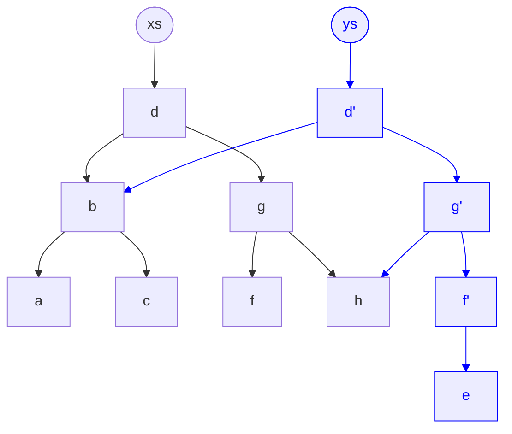

<!-- Generated by SpecStory, Markdown v2.1.0 -->

# 2026-11-05 11:47:38Z

<!-- VS Code Copilot IDE Session 980756c4-0d21-4a6a-9a39-f1d6dfe738c1 (2026-11-05 11:47:38Z) -->

_**User (2026-11-05 11:47:38Z)**_

create in docs a short .md note about immutable structures, pure functions, referential stability

and how this affects:
- signal/computed graph change detection 
- angular compoenent graph (input()) change detection
- pure pipes
- rxjs distinctUntilChanged()

- concise, scannable, lists over prose
- mermaid only if better explains

---

_**Agent (copilot/claude-haiku-5.5)**_

<tool-use data-tool-type="write" data-tool-name="create_file"><details>
<summary>Tool use: **create_file**</summary>

Created `immutability-change-detection.md`

**Input:**

- content:

```
# Immutability, pure functions, referential stability

## Core ideas

- **Immutable update**: never mutate. Build a new container or object: `[...xs, x]`, `xs.map()`, `xs.filter()`, `xs.toSorted()`, `{ ...o, done: true }`.
- **Pure function**: output depends only on inputs. No argument mutation, no side effects. Same input, same output.
- **Referential stability**: change detection compares identity (`Object.is`), not content. Same reference means no change. New reference means change, even if the content is equal.
- **Rule**: content changed, new reference. Content unchanged, keep the same reference.

## Pitfalls

- `push()`, `splice()`, `sort()`, `reverse()`, `obj.x = ...` keep the same reference, so nothing is notified.
- `signal.set(sameRef)` is a no-op (default `equal` is `Object.is`).
- Prefer `update((xs) => [...xs, x])` over `set([...xs])`. Both notify, but `update` states the intent.
- Do not call functions in templates that return new arrays or objects. Each check creates a new reference (dev mode throws NG0100). Derive in `computed()` instead.

## Signals and `computed()` graph

- `signal.set(v)` notifies dependents only when `!Object.is(old, v)`. A custom `equal` option changes this.
- A `computed()` recomputes when a dependency notifies. Its dependents are notified only if its result changes by `Object.is`.
- Pure derivations make this reliable: same inputs produce the same result, so unchanged results stop propagation.
- In-place mutation is invisible to the graph. No dependency fires.
- Never write to signals inside `computed()`.

## Component graph (`input()`)

- An input signal notifies its reader only when the bound value's reference changes.
- A mutated object passed to a child is not re-rendered. The child reads `item().name`, which changed silently.
- `OnPush` is the default in Angular v22+. A child re-renders on input change only when the reference changes.
- Parent update: `items.update((xs) => xs.map((x) => (x.id === id ? { ...x, done: true } : x)))`. The child receives a new array and updates.
- A new reference with equal content causes an unnecessary child render. Keep derived data in the child's `computed()`.

## Pure pipes

- A pure pipe re-runs only when an argument changes by reference (primitives by value).
- A mutated array or object passed to a pipe leaves the output stale. The pipe does not re-run.
- A pipe must not mutate its input or cause side effects.
- `pure: false` re-runs on every change detection. Avoid it. Fix the data flow instead.

## RxJS `distinctUntilChanged()`

- Default comparator is `===`: reference for objects and arrays, value for primitives.
- Emits only when the reference changes. Re-emitting a mutated object with the same reference is filtered out.
- Immutable updates always produce a new reference, so every emission passes.
- For key-based equality, pass a comparator: `distinctUntilChanged((a, b) => a.id === b.id)`.
- `toSignal()` and `toObservable()` follow the same identity rules on the signal side.

## Checklist

- [ ] Changed content produces a new reference
- [ ] No mutating methods on state (`push`, `splice`, `sort`); use `toSorted()`
- [ ] Derived data lives in `computed()`, not in template calls
- [ ] Inputs and pipe arguments receive new references on change
- [ ] Custom comparator when equality is by key, not by reference

```

- filePath: `c:\Projects\sages-angular-adv-1126\docs\immutability-change-detection.md`

**Result:**

```
The following files were successfully edited:
c:\Projects\sages-angular-adv-1126\docs\immutability-change-detection.md
```
</details></tool-use>

_**Agent (copilot/claude-haiku-5.5)**_

<tool-use data-tool-type="write" data-tool-name="textEditGroup"><details>
<summary>Edit: **immutability-change-detection.md**</summary>

@@ lines 1-1 @@

```
# Immutability, pure functions, referential stability

## Core ideas

- **Immutable update**: never mutate. Build a new container or object: `[...xs, x]`, `xs.map()`, `xs.filter()`, `xs.toSorted()`, `{ ...o, done: true }`.
- **Pure function**: output depends only on inputs. No argument mutation, no side effects. Same input, same output.
- **Referential stability**: change detection compares identity (`Object.is`), not content. Same reference means no change. New reference means change, even if the content is equal.
- **Rule**: content changed, new reference. Content unchanged, keep the same reference.

## Pitfalls

- `push()`, `splice()`, `sort()`, `reverse()`, `obj.x = ...` keep the same reference, so nothing is notified.
- `signal.set(sameRef)` is a no-op (default `equal` is `Object.is`).
- Prefer `update((xs) => [...xs, x])` over `set([...xs])`. Both notify, but `update` states the intent.
- Do not call functions in templates that return new arrays or objects. Each check creates a new reference (dev mode throws NG0100). Derive in `computed()` instead.

## Signals and `computed()` graph

- `signal.set(v)` notifies dependents only when `!Object.is(old, v)`. A custom `equal` option changes this.
- A `computed()` recomputes when a dependency notifies. Its dependents are notified only if its result changes by `Object.is`.
- Pure derivations make this reliable: same inputs produce the same result, so unchanged results stop propagation.
- In-place mutation is invisible to the graph. No dependency fires.
- Never write to signals inside `computed()`.

## Component graph (`input()`)

- An input signal notifies its reader only when the bound value's reference changes.
- A mutated object passed to a child is not re-rendered. The child reads `item().name`, which changed silently.
- `OnPush` is the default in Angular v22+. A child re-renders on input change only when the reference changes.
- Parent update: `items.update((xs) => xs.map((x) => (x.id === id ? { ...x, done: true } : x)))`. The child receives a new array and updates.
- A new reference with equal content causes an unnecessary child render. Keep derived data in the child's `computed()`.

## Pure pipes

- A pure pipe re-runs only when an argument changes by reference (primitives by value).
- A mutated array or object passed to a pipe leaves the output stale. The pipe does not re-run.
- A pipe must not mutate its input or cause side effects.
- `pure: false` re-runs on every change detection. Avoid it. Fix the data flow instead.

## RxJS `distinctUntilChanged()`

- Default comparator is `===`: reference for objects and arrays, value for primitives.
- Emits only when the reference changes. Re-emitting a mutated object with the same reference is filtered out.
- Immutable updates always produce a new reference, so every emission passes.
- For key-based equality, pass a comparator: `distinctUntilChanged((a, b) => a.id === b.id)`.
- `toSignal()` and `toObservable()` follow the same identity rules on the signal side.

## Checklist

- [ ] Changed content produces a new reference
- [ ] No mutating methods on state (`push`, `splice`, `sort`); use `toSorted()`
- [ ] Derived data lives in `computed()`, not in template calls
- [ ] Inputs and pipe arguments receive new references on change
- [ ] Custom comparator when equality is by key, not by reference

```
</details></tool-use>

_**Agent (copilot/claude-haiku-5.5)**_

Created `docs/immutability-change-detection.md`. It covers immutable updates, pure functions, and referential stability, then their effect on signals/`computed()`, `input()`, pure pipes, and `distinctUntilChanged()`. I skipped the Mermaid diagram because lists read better here.

Separately, in `src/app/features/deals/data/deals.store.ts#L40`, `addTask` never adds the new `task`. It copies the existing array with `[...tasks]` and drops the `task` variable. The fix is `this.tasksState.update((tasks) => [...tasks, task]);`. I did not change it since you only asked for the note.

_**Agent (copilot/claude-haiku-5.5)**_

<tool-use data-tool-type="task" data-tool-name="manage_todo_list"><details>
<summary>Tool use: **manage_todo_list**</summary>

Created 1 todo
</details></tool-use>

---

_**User (2026-11-05 11:52:18Z)**_

add mermaild diagram like one i included + short desc

---

_**Agent (copilot/claude-haiku-5.5)**_

<tool-use data-tool-type="write" data-tool-name="textEditGroup"><details>
<summary>Edit: **immutability-change-detection.md**</summary>

@@ lines 10-10 @@

````
Structural sharing

Updating one node copies only the path from the root to the change (blue). Everything else is shared by reference, so `===` checks show exactly which parts changed.



- `xs` (old) and `ys` (new) share `b`, `h`, `a`, `c`, `f`.
- New nodes: `d'`, `g'`, `f'`, `e`.

## 
````
</details></tool-use>

_**Agent (copilot/claude-haiku-5.5)**_

<tool-use data-tool-type="write" data-tool-name="textEditGroup"><details>
<summary>Edit: **immutability-change-detection.md**</summary>

@@ lines 34-35 @@

```
Shared by both versions: `b`, `h`.
- Only in new version (`ys`): `d'`, `g'`, `f'`, `e`.
- Only in old version (`xs`): `d`, `g`, `f`, `a`, `c
```
</details></tool-use>

_**Agent (copilot/claude-haiku-5.5)**_

I added a "Structural sharing" section to `docs/immutability-change-detection.md`, before "Pitfalls". It has a short description, a Mermaid diagram matching your image (new path in blue), and a list of shared and unique nodes.

_**Agent (copilot/claude-haiku-5.5)**_

<tool-use data-tool-type="task" data-tool-name="manage_todo_list"><details>
<summary>Tool use: **manage_todo_list**</summary>

Created 2 todos
</details></tool-use>

---

_**User (2026-11-05 11:53:32Z)**_

add note on https://immerjs.github.io/immer/

---

_**Agent (copilot/claude-haiku-5.5)**_

<tool-use data-tool-type="generic" data-tool-name="fetch_webpage"><details>
<summary>Tool use: **fetch_webpage**</summary>

Fetched https://immerjs.github.io/immer/

**Input:**

- query: `What is Immer, produce function, structural sharing, auto-freeze, drafts, Angular or signals usage, bundle size, and key API`
- urls: `["https://immerjs.github.io/immer/"]`

**Result:**

```
Here is some relevant context from the web page https://immerjs.github.io/immer/:
...
# Introduction to Immer

  [Sponsored: EthicalAds](https://server.ethicalads.io/proxy/click/8173/01a1ab8e-ae8c-7343-bc5f-88eea2cd1762/) [EthicalAds is a GDPR-compliant ad network for devs No cookie banners, and only
dev-focused ads.](https://server.ethicalads.io/proxy/click/8173/01a1ab8e-ae8c-7343-bc5f-88eea2cd1762/) www.ethicalads.io [Ads by EthicalAds](https://www.ethicalads.io/advertisers/topics/frontend-web/?ref=ea-image)


...
...
# Immer
...
### Immer simplifies handling immutable data structuresDirect link to Immer simplifies handling immutable data structures


Immer can be used in any context in which immutable data structures need to be
used. For example in combination with React state, React or Redux reducers, or
configuration management. Immutable data structures allow for (efficient) change
detection: if the reference to an object didn't change, the object itself did not
change. In addition, it makes cloning relatively cheap: Unchanged parts of a
data tree don't need to be copied and are shared in memory with older versions of
the same state.


Generally speaking, these benefits can be achieved by making sure you never
change any property of an object, array or map, but by always creating an altered
copy instead. In practice this can result in code that is quite cumbersome to
write, and it is easy to accidentally violate those constraints. Immer will help you
to follow the immutable data paradigm by addressing these pain points:


1. Immer will detect accidental mutations and throw an error.
...
...
# Immer
...
### Immer simplifies handling immutable data structuresDirect link to Immer simplifies handling immutable data structures
...
2. Immer will remove the need for the typical boilerplate code that is needed when
creating deep updates to immutable objects: Without Immer, object copies need to
be made by han
… (output truncated)
```
</details></tool-use>

_**Agent (copilot/claude-haiku-5.5)**_

<tool-use data-tool-type="generic" data-tool-name="fetch_webpage"><details>
<summary>Tool use: **fetch_webpage**</summary>

Fetched https://immerjs.github.io/immer/produce

**Input:**

- query: `produce returns same reference when no changes made, auto freeze, recipe returns, curried produce`
- urls: `["https://immerjs.github.io/immer/produce"]`

**Result:**

```
Here is some relevant context from the web page https://immerjs.github.io/immer/produce:
...
# Using produce
...
## Example[Direct link to Example](https://immerjs.github.io/immer/produce/#example)
...
### Terminology[Direct link to Terminology](https://immerjs.github.io/immer/produce/#terminology)


• `(base)state`, the immutable state passed to `produce`
• `recipe`: the second argument of `produce`, that captures how the base state should be "mutated".
• `draft`: the first argument of any `recipe`, which is a proxy to the original base state that can be safely mutated.
• `producer`. A function that uses `produce` and is generally of the form `(baseState, ...arguments) => resultState`


Note that it isn't strictly necessary to name the first argument of the recipe `draft`. You can name it anything you want, for example `users`. Using `draft` as a name is just a convention to signal: "mutation is OK here".

 [Edit this page](https://github.com/immerjs/immer/edit/main/website/docs/produce.mdx) Copyright © 2026 Michel Weststrate

...
...
# Using produce
...
## Example[Direct link to Example](https://immerjs.github.io/immer/produce/#example)

  `import` `{`produce`}` `from` `"immer"` `const` baseState `=` `[`    `{`        `title`:` `
"Learn TypeScript"`,`        `done`:` `true`    `}`,`    `{`        `title`:` `"Try Immer"`,`        `done`:` `false`    `
}`]` `const` nextState `=` `produce`(`baseState`,` `draftState` `=>` `{`    draftState`.`push`(`{`title`
:` `"Tweet about it"`}`)`    draftState`[`1`]`.`done` `=` `true`}`)`   `// the new item is only added to the next state,`// base state is unmodified`
expect`(`baseState`.`length`)`.`toBe`(`2`)`expect`(`nextState`.`length`)`.`toBe`(`3`)` `
...
...
# Using produce
...
## Example[Direct link to Example](https://immerjs.github.io/immer/produce/#example)
...
// same for the changed 'done' prop`expect`(`baseState`[`1`]`.`done`)`.`toBe`(`false`)`expect`(`nextState`[`1`]`.`done`)`.`toBe`(`true`)` `
// unchanged data is str
… (output truncated)
```
</details></tool-use>

_**Agent (copilot/claude-haiku-5.5)**_

<tool-use data-tool-type="write" data-tool-name="textEditGroup"><details>
<summary>Edit: **immutability-change-detection.md**</summary>

@@ lines 38-38 @@

````
Immer

[Immer](https://immerjs.github.io/immer/) (about 3 KB gzipped) writes immutable updates as mutations on a draft.

- `produce(base, recipe)` returns `nextState`. `base` is never changed.
- The `draft` is a Proxy. Normal mutations (`push`, `splice`, `x.done = true`) are recorded and turned into copies.
- Structural sharing: unchanged branches keep the same reference (`next[0] === base[0]`).
- Changed branches get new references, so `===` change detection still works.
- Freezes produced data, and reports accidental mutations.
- Pure function, so it fits inside `signal.update()`.

```ts
import { produce } from 'immer';

this.tasksState.update((tasks) =>
  produce(tasks, (draft) => {
    const task = draft.find((t) => t.id === taskId);
    if (task) task.done = !task.done;
  }),
);
```

- Use Immer for deep or nested updates.
- Use plain spread for small, flat updates. It adds no dependency.

## 
````
</details></tool-use>

_**Agent (copilot/claude-haiku-5.5)**_

I added an "Immer" section to `docs/immutability-change-detection.md`, before "Pitfalls". It covers what Immer does (per the [introduction](https://immerjs.github.io/immer/) and [produce](https://immerjs.github.io/immer/produce) pages), a `signal.update()` example, and when to use it versus plain spread.

_**Agent (copilot/claude-haiku-5.5)**_

<tool-use data-tool-type="task" data-tool-name="manage_todo_list"><details>
<summary>Tool use: **manage_todo_list**</summary>

Created 3 todos
</details></tool-use>
