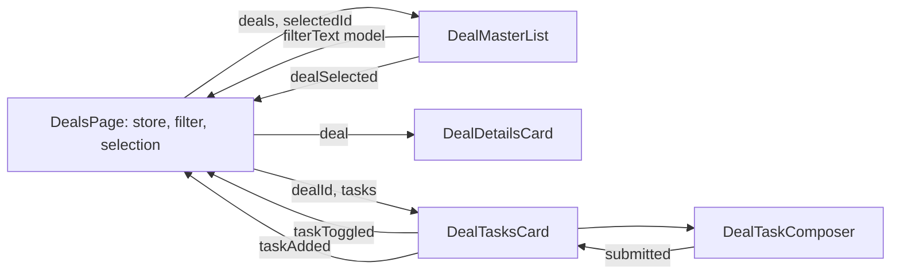

<!-- Generated by SpecStory, Markdown v2.1.0 -->

# 2026-11-05 12:52:13Z

<!-- VS Code Copilot IDE Session 912833a2-3f36-411d-998c-8a83be1a389b (2026-11-05 12:52:13Z) -->

_**User (2026-11-05 12:52:13Z)**_

plan extracting components

- propose children + roles/responsibilities
- propose input/output flow
- propose @if/else modes


---

_**Agent (copilot/claude-haiku-5.5)**_

I'll read the related shared, store, model, and pipe files before drafting the plan.       

_**Agent (copilot/claude-haiku-5.5)**_

<tool-use data-tool-type="read" data-tool-name="read_file"><details>
<summary>Tool use: **read_file**</summary>

Read `deals.store.ts`

**Input:**

- endLine: `200`
- filePath: `c:\Projects\sages-angular-adv-1126\src\app\features\deals\data\deals.store.ts`
- startLine: `1`

**Result:**

```
import { Service, signal } from '@angular/core';
import { Account } from '../model/account.model';
import { Contact } from '../model/contact.model';
import { Deal } from '../model/deal.model';
import { DealTask, TaskPriority } from '../model/deal-task.model';
import { SEED_ACCOUNTS, SEED_CONTACTS, SEED_DEALS, SEED_TASKS } from './deals-seed';

// @Injectable({providedIn:'root'}) // default o root lifecycle if non other available

@Service()
export class DealsStore {
  // Read-Write Side - Private to Owner (my wallet!)
  private readonly dealsState = signal<Deal[]>(SEED_DEALS);

  // private readonly tasksState = signal<DealTask[]>(SEED_TASKS);
  private readonly tasksState = signal<ReadonlyArray<DealTask>>(SEED_TASKS);

  private readonly accountsState = signal<Account[]>(SEED_ACCOUNTS);
  private readonly contactsState = signal<Contact[]>(SEED_CONTACTS);

  // Read-Side: Public API
  readonly accounts = this.accountsState.asReadonly();
  readonly contacts = this.contactsState.asReadonly();

  filterDeals(text: string): Deal[] {
    const query = text.trim().toLowerCase();
    if (!query) return this.dealsState();

    return this.dealsState().filter((deal) =>
      [deal.title, this.accountName(deal.accountId), this.contactName(deal.contactId)].some(
        (value) => value.toLowerCase().includes(query),
      ),
    );
  }

  getTasksForDeal(dealId: string): DealTask[] {
    return this.tasksState().filter((task) => task.dealId === dealId);
  }

  addTask(dealId: string, title: string, priority: TaskPriority): void {
    const task: DealTask = { id: crypto.randomUUID(), dealId, title, priority, done: false };

    // Mutating Signal() State
    const tasks = this.tasksState();

    // Mutation - content changes, Container Reference is the same
    // tasks.push(task); // Compile Error - READONLYArray!

    // tasks.sort -> tasks.toSorted() // ES2025

    // Referential stability - oldRef === newRef - same object -> no changes !!!!
    // this.tasksState.set(tasks
… (output truncated)
```
</details></tool-use>

_**Agent (copilot/claude-haiku-5.5)**_

<tool-use data-tool-type="read" data-tool-name="read_file"><details>
<summary>Tool use: **read_file**</summary>

Read `deal-task.model.ts`

**Input:**

- endLine: `200`
- filePath: `c:\Projects\sages-angular-adv-1126\src\app\features\deals\model\deal-task.model.ts`
- startLine: `1`

**Result:**

```
export type TaskPriority = 'low' | 'medium' | 'high';

export const TASK_PRIORITY_LABELS: Record<TaskPriority, string> = {
  low: 'Low',
  medium: 'Medium',
  high: 'High',
};

export interface DealTask {
  id: string;
  dealId: string;
  title: string;
  // yyyy-mm-dd; undefined means no due date
  dueDate?: string;
  priority: TaskPriority;
  done: boolean;
}
```
</details></tool-use>

_**Agent (copilot/claude-haiku-5.5)**_

<tool-use data-tool-type="read" data-tool-name="read_file"><details>
<summary>Tool use: **read_file**</summary>

Read `account-name-pipe.ts`

**Input:**

- endLine: `100`
- filePath: `c:\Projects\sages-angular-adv-1126\src\app\features\deals\ui\pipes\account-name-pipe.ts`
- startLine: `1`

**Result:**

```
import { inject, Pipe, PipeTransform } from '@angular/core';
import { DealsStore } from '../../data/deals.store';

@Pipe({
  name: 'accountName',
})
export class AccountNamePipe implements PipeTransform {
  private readonly store = inject(DealsStore);

  transform(accountId: string): string {
    return this.store.accountName(accountId);
  }
}
```
</details></tool-use>

_**Agent (copilot/claude-haiku-5.5)**_

<tool-use data-tool-type="read" data-tool-name="read_file"><details>
<summary>Tool use: **read_file**</summary>

Read `index.ts`

**Input:**

- endLine: `100`
- filePath: `c:\Projects\sages-angular-adv-1126\src\app\shared\index.ts`
- startLine: `1`

**Result:**

```
export * from './shared-module';
export * from './layouts/master-detail-layout/master-detail-layout';
```
</details></tool-use>

_**Agent (copilot/claude-haiku-5.5)**_

<tool-use data-tool-type="read" data-tool-name="read_file"><details>
<summary>Tool use: **read_file**</summary>

Read `master-detail-layout.ts`

**Input:**

- endLine: `200`
- filePath: `c:\Projects\sages-angular-adv-1126\src\app\shared\layouts\master-detail-layout\master-detail-layout.ts`
- startLine: `1`

**Result:**

````
import { Component } from '@angular/core';

/**
 * Two-column master-detail layout that stacks on mobile and goes side by side from `md`.
 *
 * Rationale: one shared grid keeps the column widths and breakpoint consistent across features,
 * and consumers only supply content.
 *
 * Slots:
 * - `[appMasterDetailList]` element: left column (master list).
 * - Any other content: right column (detail).
 *
 * Snippets: `mdl` (layout), `mdl-item` (master list item).
 *
 * @example
 * ```html
 * <app-master-detail-layout>
 *   <aside appMasterDetailList>
 *     <mat-list>...</mat-list>
 *   </aside>
 *
 *   <div>...detail content...</div>
 * </app-master-detail-layout>
 * ```
 */
@Component({
  selector: 'app-master-detail-layout',
  host: {
    class:
      'grid min-h-screen  grid-cols-1 gap-5 md:grid-cols-[minmax(200px,1fr)_3fr] md:items-start',
    '[class.banana]': '1 < 2',
  },
  template: `
    <aside class="min-w-0">
      <ng-content select="[appMasterDetailList]" />
    </aside>

    <div class="min-w-0">
      <ng-content />
    </div>
  `,
  styles: [],
})
export class MasterDetailLayout {}
````
</details></tool-use>

_**Agent (copilot/claude-haiku-5.5)**_

<tool-use data-tool-type="read" data-tool-name="read_file"><details>
<summary>Tool use: **read_file**</summary>

Read `shared-module.ts`

**Input:**

- endLine: `200`
- filePath: `c:\Projects\sages-angular-adv-1126\src\app\shared\shared-module.ts`
- startLine: `1`

**Result:**

```
import { NgModule } from '@angular/core';
import { CommonModule } from '@angular/common';

import { MatButton } from '@angular/material/button';
import {
  MatCard,
  MatCardActions,
  MatCardContent,
  MatCardHeader,
  MatCardSubtitle,
  MatCardTitle,
} from '@angular/material/card';
import { MatCheckbox } from '@angular/material/checkbox';
import { MatChip, MatChipSet } from '@angular/material/chips';
import { MatFormField, MatLabel, MatSuffix } from '@angular/material/form-field';
import { MatIcon } from '@angular/material/icon';
import { MatInput } from '@angular/material/input';
import {
  MatList,
  MatListItem,
  MatListItemIcon,
  MatListItemLine,
  MatListItemMeta,
  MatListItemTitle,
} from '@angular/material/list';
import { MatOption, MatSelect } from '@angular/material/select';
import { MatToolbar } from '@angular/material/toolbar';
import { MatLineModule } from '@angular/material/core';
import { RouterLink, RouterLinkActive } from '@angular/router';

// const SharedImports = [
// ]

export const SharedForms = [
  MatOption,
  MatSelect,
  MatSuffix,
  MatCheckbox,
  MatFormField,
  MatInput,
  MatLabel,
  [[[MatButton]]],
];

export const SharedUI = [
  CommonModule,

  MatButton,
  MatCard,
  MatCardActions,
  MatCardContent,
  MatCardHeader,
  MatCardSubtitle,
  MatCardTitle,

  MatChip,
  MatChipSet,
  MatIcon,
  MatList,
  // MatLineModule,
  MatListItem,
  MatListItemLine,
  MatListItemMeta,
  MatListItemTitle,
  MatListItemIcon,
  MatToolbar,

  RouterLink,
  RouterLinkActive,
];

export const SharedImports = [
  CommonModule,
  SharedForms,
  //
  SharedUI,
];

@NgModule({
  declarations: [],
  imports: [SharedImports],
  exports: [
    // ...SharedImports
    SharedImports,
  ],
})
export class SharedModule {}
```
</details></tool-use>

_**Agent (copilot/claude-haiku-5.5)**_

<tool-use data-tool-type="read" data-tool-name="read_file"><details>
<summary>Tool use: **read_file**</summary>

Read `deal.model.ts`

**Input:**

- endLine: `200`
- filePath: `c:\Projects\sages-angular-adv-1126\src\app\features\deals\model\deal.model.ts`
- startLine: `1`

**Result:**

```
export type DealStage = 'new' | 'proposal' | 'negotiation' | 'closed-won' | 'closed-lost';

export const DEAL_STAGE_LABELS: Record<DealStage, string> = {
  new: 'New',
  proposal: 'Proposal',
  negotiation: 'Negotiation',
  'closed-won': 'Closed won',
  'closed-lost': 'Closed lost',
};

export interface Money {
  amount: number;
  currency: 'USD';
}

export interface Deal {
  id: string;
  title: string;
  summary: string;
  stage: DealStage;
  value: Money;
  accountId: string;
  contactId: string;
  isPublic: boolean;
}
```
</details></tool-use>

_**Agent (copilot/claude-haiku-5.5)**_

<tool-use data-tool-type="generic" data-tool-name="memory"><details>
<summary>Tool use: **memory**</summary>

Created memory file `plan.md`

**Input:**

- command: `create`
- file_text:

````
## Plan: Extract deals-list page into child components

Split `DealsPage` (deals-list.page.ts) into four presentational children under `features/deals/ui/`. The page keeps store, filter, and selection state and becomes an orchestrator. Children get data through `input()` / `model()` and report through `output()`. Task draft state moves into the composer. Empty and absent cases use `@empty` and `@else`.

**Steps**
1. Create `DealMasterList` (`ui/deal-master-list`). Filter field plus `mat-list`. Inputs: `deals` (required), `selectedId`. Model: `filterText`. Output: `dealSelected` (string id). Host gets the `appMasterDetailList` attribute at the usage site.
2. Create `DealDetailsCard` (`ui/deal-details-card`). Input: `deal` (required). Renders title, account, summary, stage, value, contact, public flag. Edit button stays a no-op.
3. Create `DealTasksCard` (`ui/deal-tasks-card`). Inputs: `dealId`, `tasks`. Outputs: `taskAdded` ({ title, priority }), `taskToggled` (id). Contains the `@for` task list and `DealTaskComposer`.
4. Create `DealTaskComposer` (`ui/deal-task-composer`). Owns its own `form()` draft, priority options, and reset. Output: `submitted` ({ title, priority }). Emits only when the trimmed title is non-empty, then resets. Steps 1-4 are independent and can run in parallel.
5. Rewrite `DealsPage` (*depends on 1-4*). Remove `taskDraft`, `taskForm`, `priorities`, `priorityLabels`, and the `FormField` import. Keep `store`, `filterText`, `selectedDealId`, `filteredDeals`, `selectedDeal`, `selectedTasks`. `addTask` becomes `addTask(dealId, { title, priority })`.
6. Cleanup inside changed files: switch `'../../../../shared'` to `@shared` (architecture rule). Remove the page `styles` block that uses `!important` and the `special-chip-override` class. Move any still-needed chip styling into the child that renders the chips, and check whether `!important` is actually required.

**Relevant files**
- `src/app/features/deals/pages/deals-list/deals-list.page.ts`: source of extraction. Keep `providers: [DealsStore]` here.
- `src/app/features/deals/ui/` (new children): sits next to the existing `ui/pipes/`.
- `src/app/shared/index.ts` and `src/app/shared/shared-module.ts`: reuse `SharedForms` and `SharedUI` / `SharedImports` through `@shared`.
- `src/app/shared/layouts/master-detail-layout/master-detail-layout.ts`: `[appMasterDetailList]` slot is matched on the child host element, so `<app-deal-master-list appMasterDetailList>` projects correctly.
- `src/app/features/deals/data/deals.store.ts`: unchanged. Used by the page and by the `AccountNamePipe` / `ContactNamePipe` pipes.
- `src/app/features/deals/model/deal.model.ts` and `deal-task.model.ts`: types for inputs (`Deal`, `DealTask`, `TaskPriority`, labels).

**Proposed children: roles and responsibilities**

| Child | Responsibility | Inputs | Model | Outputs |
| --- | --- | --- | --- | --- |
| `DealMasterList` | Search field and the list of deal rows | `deals: Deal[]`, `selectedId: string \| null` | `filterText: string` | `dealSelected: string` |
| `DealDetailsCard` | Read-only summary of one deal | `deal: Deal` | none | none (optional `edit` later) |
| `DealTasksCard` | Task section for one deal: list and toggle | `dealId: string`, `tasks: readonly DealTask[]` | none | `taskAdded: {title, priority}`, `taskToggled: string` |
| `DealTaskComposer` | New task form with local draft | none | none | `submitted: {title, priority}` |

**Input/output flow**



Only the page talks to the store. Children never inject `DealsStore` directly.

**Conditional modes (`@if` / `@else` / `@empty`)**

| Location | Condition | Branch |
| --- | --- | --- |
| `DealsPage` template | `@if (selectedDeal(); as deal)` | Details and tasks. `@else`: empty state "Select a deal" (no deals, or no filter match). |
| `DealMasterList` list | `@for ... @empty` | "No deals match the filter" |
| `DealTasksCard` list | `@for ... @empty` | "No tasks yet" |
| `DealTaskComposer` Add button | binding, not a branch | `[disabled]="!title().trim()"` |
| `DealTasksCard` row | existing `@if (task.dueDate)` | Keep as is |
| Optional, out of scope | `DealDetailsCard`: `@if (editing()) {form} @else {read-only}` | Only if the Edit button should switch modes. Excluded by default. |

**Verification**
1. `npx prettier --write` on each changed or new file.
2. `npx tsc --noEmit -p tsconfig.app.json`.
3. `npx eslint <changed files>` and run the `module-boundaries` skill for the new `ui/` children.
4. Confirm `ng serve` rebuilds without errors. The open browser tab shows an Error page at `/deals`, so check that the baseline works before refactoring.
5. Manual checks, only after asking for browser tools: filter to zero matches (list `@empty`, detail `@else`), select a different deal, add a task with an empty title (no-op), add a valid task (composer resets), toggle a task, confirm rows keep their `aria-current`.

**Decisions**
- Children are presentational. They take data through inputs and do not inject the store.
- Pipes `accountName` and `contactName` still inject `DealsStore`. They resolve through the page's `providers` as long as children render inside `DealsPage`. Recommended for this step; passing names as inputs is the stricter alternative.
- Edit and Archive buttons stay no-ops (no new outputs).
- Excluded: store, models, routes, `feature index.ts` (children are internal to the deals feature, so no export), and the `CommonModule` in `SharedUI`.
- Generate the four children with `ng g c` (workflow rule). Do not write them by hand.

**Further Considerations**
1. Pipes read the store (keep, recommended) vs. names passed as inputs (fully pure children). Option A is minimal, Option B is stricter.
2. Extract a single `DealTaskItem` row component? Recommend no for now. The row is about 12 lines and not reused. Extract only if it grows.
3. Should `DealDetailsCard` get a real edit mode with `@if (editing())`? Recommend no, since it is a separate feature.

````

- path: `/memories/session/plan.md`

**Result:**

```
File created successfully at: /memories/session/plan.md
```
</details></tool-use>

_**Agent (copilot/claude-haiku-5.5)**_

## Plan: Extract deals-list page into child components

Split `DealsPage` (deals-list.page.ts) into four presentational children under `features/deals/ui/`. The page keeps the store, filter, and selection state and becomes an orchestrator. Children receive data through `input()` / `model()` and report through `output()`. Task draft state moves into the composer. Empty and absent cases use `@empty` and `@else`.

**Steps**
1. Create `DealMasterList` (`ui/deal-master-list`): filter field plus `mat-list`. Inputs: `deals` (required), `selectedId`. Model: `filterText`. Output: `dealSelected` (string id). The host gets the `appMasterDetailList` attribute at the usage site.
2. Create `DealDetailsCard` (`ui/deal-details-card`): input  (required). Renders title, account, summary, stage, value, contact, and public flag. The Edit button stays a no-op.
3. Create `DealTasksCard` (`ui/deal-tasks-card`): inputs  and . Outputs `taskAdded` ({ title, priority }) and `taskToggled` (id). Contains the `@for` task list and `DealTaskComposer`.
4. Create `DealTaskComposer` (`ui/deal-task-composer`): owns its own `form()` draft, priority options, and reset. Output `submitted` ({ title, priority }). Emits only when the trimmed title is non-empty, then resets. Steps 1-4 are independent and can run in parallel.
5. Rewrite `DealsPage` (*depends on 1-4*): remove `taskDraft`, `taskForm`, `priorities`, `priorityLabels`, and the `FormField` import. Keep , `filterText`, `selectedDealId`, `filteredDeals`, `selectedDeal`, and `selectedTasks`.  becomes .
6. Cleanup in changed files: change `'../../../../shared'` to `@shared` (architecture rule). Remove the page  block that uses `!important` and the `special-chip-override` class. Move any still-needed chip styling into the child that renders the chips, and check whether `!important` is actually required.

**Relevant files**
- `src/app/features/deals/pages/deals-list/deals-list.page.ts`: extraction source. Keep `providers: [DealsStore]` here.
- `ui` (new children): sits next to the existing ui/pipes.
- `src/app/shared/shared-module.ts`: reuse  and  /  through `@shared`.
- `src/app/shared/layouts/master-detail-layout/master-detail-layout.ts`: the `[appMasterDetailList]` slot matches the child host element, so `<app-deal-master-list appMasterDetailList>` projects correctly.
- `src/app/features/deals/data/deals.store.ts`: unchanged. Used by the page and by the pipes.
- `src/app/features/deals/model/deal.model.ts` and `src/app/features/deals/model/deal-task.model.ts`: types for inputs (, , , labels).

**Proposed children: roles and responsibilities**

| Child | Responsibility | Inputs | Model | Outputs |
| --- | --- | --- | --- | --- |
| `DealMasterList` | Search field and deal row list | `deals: Deal[]`, `selectedId: string \| null` | `filterText: string` | `dealSelected: string` |
| `DealDetailsCard` | Read-only summary of one deal | `deal: Deal` | none | none (optional `edit` later) |
| `DealTasksCard` | Task section for one deal: list and toggle | `dealId: string`, `tasks: readonly DealTask[]` | none | `taskAdded: {title, priority}`, `taskToggled: string` |
| `DealTaskComposer` | New-task form with local draft | none | none | `submitted: {title, priority}` |

**Input/output flow**


Only the page talks to the store. Children never inject  directly.

**Conditional modes (`@if` / `@else` / `@empty`)**

| Location | Condition | Branch |
| --- | --- | --- |
| `DealsPage` template | `@if (selectedDeal(); as deal)` | Details and tasks. `@else`: empty state "Select a deal" (no deals, or no filter match). |
| `DealMasterList` list | `@for ... @empty` | "No deals match the filter" |
| `DealTasksCard` list | `@for ... @empty` | "No tasks yet" |
| `DealTaskComposer` Add button | binding, not a branch | `[disabled]="!title().trim()"` |
| `DealTasksCard` row | existing `@if (task.dueDate)` | Keep as is |
| Optional, out of scope | `DealDetailsCard`: `@if (editing()) {form} @else {read-only}` | Only if the Edit button should switch modes. Excluded by default. |

**Verification**
1. `npx prettier --write` on each changed or new file.
2. `npx tsc --noEmit -p tsconfig.app.json`.
3. `npx eslint <changed files>`, then run the `module-boundaries` skill on the new `ui/` children.
4. Confirm `ng serve` rebuilds without errors. The open browser tab shows an Error page at `/deals`, so check that the baseline works before refactoring.
5. Manual checks, only after you approve browser tools: filter to zero matches (list `@empty`, detail `@else`), select a different deal, add a task with an empty title (no-op), add a valid task (composer resets), toggle a task, and confirm `aria-current` stays on the selected row.

**Decisions**
- Children are presentational. They take data through inputs and do not inject the store.
- The pipes  and  still inject . They resolve through the page's `providers` as long as the children render inside `DealsPage`. Recommended for this step; passing names as inputs is the stricter alternative.
- Edit and Archive stay no-ops (no new outputs).
- Excluded: store, models, routes, the feature `index.ts` (children are internal to the deals feature, so no export), and the  in .
- Generate the four children with `ng g c` (workflow rule), not by hand.

**Further Considerations**
1. Pipes read the store (keep, recommended) vs. names passed as inputs (fully pure children). Option A is minimal; Option B is stricter.
2. Extract a single `DealTaskItem` row component? Recommend no for now. The row is about 12 lines and not reused.
3. Should `DealDetailsCard` get a real edit mode with `@if (editing())`? Recommend no, since it is a separate feature.

The plan is saved to `/memories/session/plan.md`. Tell me which options to take for the pipes (1) and the edit mode (3), and I'll refine the plan before any implementation.

_**Agent (copilot/claude-haiku-5.5)**_

<tool-use data-tool-type="task" data-tool-name="manage_todo_list"><details>
<summary>Tool use: **manage_todo_list**</summary>

Created 3 todos
</details></tool-use>

---

_**User (2026-11-05 13:06:36Z)**_

stub: edit, create new, cancel, save etc. action buttons stub functions
stub deal-editor component +  switching modes -  details|editor|creator

mark as todo in docs for later - pipes store dependency

---

_**Agent (copilot/claude-haiku-5.5)**_

<tool-use data-tool-type="read" data-tool-name="read_file"><details>
<summary>Tool use: **read_file**</summary>

Read `notatki.md`

**Input:**

- endLine: `200`
- filePath: `c:\Projects\sages-angular-adv-1126\notatki.md`
- startLine: `1`

**Result:**

```
# Instalacje 

node -v
npm -v 
git -v 

# GIT 
git clone ...

CTRL+SHIFT+P  -> CLONE -> paste -> url -> destination -> open..

https://github.com/ev45ive/sages-angular-adv-1126

# Angular CLI
ng version
Angular CLI       : 22.2.5

npm i -g @angular/cli@latest
npm i -g @angular/cli@^22.0.0
npm i -g @angular/cli@22.2.5

# ng new - workspace

ng new sages --directory "." -s -t --skip-tests --routing --ssr true --standalone true --style tailwind --zoneless false

# npm + semver + package-lock.json
https://semver.org/
https://semver.npmjs.com/

npm i  // package.json upgrade
npm ci // package-lock.json exact


# Material
ng add @angular/


# Design Tokens

https://m3.material.io/foundations/design-tokens/overview
https://v21.primeng.org/theming/styled#architecture

# Flex
https://css-tricks.com/snippets/css/a-guide-to-flexbox/

http://www.flexboxdefense.com/
https://flexboxfroggy.com/


# CSS GRID
https://css-tricks.com/complete-guide-css-grid-layout/
https://cssgridgarden.com/


# CSS Specifity
https://css-tricks.com/specifics-on-css-specificity/ 


# Decision Criteria - Constraints / Forcing Functions

- Reusability - DRY-3x / YAGNI

- Responsibility - SRP - Single Reason to Change
        - What will change together says together
        - What will change separatly gets separated

- Extensibility 
        - Open/Closed - If its different responsibility:
        - Use extension/port/outlet/input/slot/params/...

- Ownership
    - who can change this, upstream to consumers (dependecies)

- Scope
    - Impact radius - what dependecies will be affected

- Lifecyle 
    - When it is created, changes state and destoryed
    - How often it changes state
    - Rate of change (how often it changes, together with what)
    - Staleness budget, invaidation etc..


# Komponenty

ui - Komponent "prezentacyjny" - zależy od rodzica (page)
page - Komponent "kontrolujący" - ładuje dane dla dzieci
… (output truncated)
```
</details></tool-use>

_**Agent (copilot/claude-haiku-5.5)**_

<tool-use data-tool-type="read" data-tool-name="read_file"><details>
<summary>Tool use: **read_file**</summary>

Read `ARCHITECTURE.md`

**Input:**

- endLine: `300`
- filePath: `c:\Projects\sages-angular-adv-1126\docs\ARCHITECTURE.md`
- startLine: `1`

**Result:**

````
# Architecture

Target structure. Decisions and rationale are in the [ADR index](adr/index.md).

```sh
src/
├── main.ts
├── index.html
├── styles.css                      # Global styles, tokens, layers
│
└── app/
    ├── app.ts                      # Root component
    ├── app.config.ts               # Global providers
    ├── app.routes.ts               # Root routes, features via loadChildren (ADR-0004)
    │
    ├── core/                       # App-wide infrastructure and app-level pages
    │   ├── index.ts                # Public API (exports PageNotFound)
    │   ├── pages/
    │   │   └── page-not-found/page-not-found.ts
    │   ├── auth/                   # Planned
    │   ├── http/                   # Planned
    │   └── layout/                 # Planned
    │
    ├── features/                   # Business capabilities (ADR-0001)
    │   └── deals/
    │       ├── index.ts            # Public API, the only file other features may import; re-exports dealsRoutes (ADR-0002)
    │       ├── deals.routes.ts     # Feature routes, default export
    │       ├── pages/              # Routable, compose UI + state
    │       │   └── deals-list/deals-list.page.ts
    │       ├── ui/                 # Feature-specific presentation
    │       ├── data/               # Data access + state
    │       └── model/              # Domain contracts + logic
    │
    └── shared/                     # Domain-independent reusable code
        ├── index.ts                # Public API, re-exports shared-module
        ├── shared-module.ts        # Shared Material/Router imports
        ├── ui/
        ├── forms/
        ├── directives/
        ├── pipes/
        ├── layouts/
        └── utils/
```

## Responsibilities and boundaries

| Directory           | Responsibility                                | Typical contents                     |
| ------------------- | --------------------------------------------- | ------------------------------------ |
| `core/`             | Ap
… (output truncated)
````
</details></tool-use>

_**Agent (copilot/claude-haiku-5.5)**_

<tool-use data-tool-type="generic" data-tool-name="memory"><details>
<summary>Tool use: **memory**</summary>

Created memory file `plan.md`

**Input:**

- command: `create`
- file_text:

```
## Plan: Extract deals-list children, stub actions and modes

TL;DR: Split `DealsPage` into presentational children under `features/deals/ui/`. Add stubbed actions (Edit, Create new, Cancel, Save, Archive completed) as no-op page methods with one-line TODOs. Add a `viewMode` signal (`details | editor | creator`) that switches the detail column. Stub `DealEditor` for editor and creator modes. Record the pipes-to-store dependency as a TODO in `docs/ARCHITECTURE.md`.

**Steps**
1. Create `DealMasterList` (`ui/deal-master-list`). Filter field, "Create new" button in the header, and `mat-list`. Inputs: `deals` (required), `selectedId`. Model: `filterText`. Outputs: `dealSelected` (string), `createRequested` (void). Host gets `appMasterDetailList` at the usage site. *Parallel with 2-4.*
2. Create `DealDetailsCard` (`ui/deal-details-card`). Input: `deal` (required). Output: `editRequested` (void). Edit button emits; no store call.
3. Create `DealTasksCard` (`ui/deal-tasks-card`). Inputs: `dealId`, `tasks`. Outputs: `taskAdded` ({ title, priority }), `taskToggled` (id), `archiveCompletedRequested` (void). Contains the `@for ... @empty` task list and `DealTaskComposer`.
4. Create `DealTaskComposer` (`ui/deal-task-composer`). Owns its `form()` draft, priority options, and reset. Output: `submitted` ({ title, priority }). Emits only when the trimmed title is non-empty. Add button `[disabled]="!title().trim()"`.
5. Create `DealEditor` stub (`ui/deal-editor`). Inputs: `mode` ('editor' | 'creator'), `deal` (optional; undefined in creator mode). Outputs: `saved` (void, payload TODO), `cancelled` (void). Header shows "Edit deal" or "New deal". Cancel and Save buttons emit only. No form fields yet. *Parallel with 1-4.*
6. Rewrite `DealsPage` (*depends on 1-5*):
   - Add `viewMode = signal<'details' | 'editor' | 'creator'>('details')`.
   - Remove `taskDraft`, `taskForm`, `priorities`, `priorityLabels`, and the `FormField` import.
   - Keep `store`, `filterText`, `selectedDealId`, `filteredDeals`, `selectedDeal`, `selectedTasks`.
   - Stub methods, each with a one-line TODO: `onEditDeal()`, `onCreateDeal()`, `onCancelEdit()`, `onSaveDeal()`, `onArchiveCompleted()`.
   - `addTask(dealId, { title, priority })` stays real (calls `store.addTask`).
   - `toggleTask` stays real.
   - Selecting a deal sets `viewMode` to `details`.
7. Mode transitions: Edit → `editor`. Create new → `creator`. Cancel → `details`. Save → `details` (stub, no persistence). Select deal → `details`.
8. Template shape for the detail column:
   - `@if (viewMode() === 'details')`: `@if (selectedDeal(); as deal)` renders details card and tasks card, `@else` renders the "Select a deal" empty state.
   - `@else if (viewMode() === 'editor')`: `<app-deal-editor mode="editor" [deal]="selectedDeal()" />`.
   - `@else`: `<app-deal-editor mode="creator" />`.
   - Wire `saved` and `cancelled` to `onSaveDeal()` and `onCancelEdit()`.
9. Cleanup in changed files: change `'../../../../shared'` to `@shared`. Remove the page `styles` block with `!important` and the `special-chip-override` class. Move still-needed chip styles into the child that renders them.
10. Docs (*parallel with 1-9*): add a `## TODO` section at the end of `docs/ARCHITECTURE.md`. Entry: `AccountNamePipe` and `ContactNamePipe` in `features/deals/ui/pipes` inject `DealsStore` (data). This deviates from the `ui → model` rule. Options for later: pass names as inputs, or move the lookup to the page. Do not create a new markdown file.

**Relevant files**
- `src/app/features/deals/pages/deals-list/deals-list.page.ts`: orchestrator. Keep `providers: [DealsStore]`.
- `src/app/features/deals/ui/` (new): `deal-master-list`, `deal-details-card`, `deal-tasks-card`, `deal-task-composer`, `deal-editor`. Sits next to `ui/pipes/`.
- `src/app/features/deals/ui/pipes/account-name-pipe.ts` and `contact-name-pipe.ts`: unchanged in code. Documented only.
- `src/app/shared/shared-module.ts`: reuse `SharedForms` and `SharedUI` / `SharedImports` through `@shared`.
- `src/app/shared/layouts/master-detail-layout/master-detail-layout.ts`: `appMasterDetailList` slot on `<app-deal-master-list>`.
- `src/app/features/deals/data/deals.store.ts`: unchanged.
- `src/app/features/deals/model/deal.model.ts`, `deal-task.model.ts`: input types.
- `docs/ARCHITECTURE.md`: receives the TODO section. Allowed by AGENTS.md. `notatki.md` is personal notes; not used.

**Child roles and I/O**

| Child | Inputs | Model | Outputs |
| --- | --- | --- | --- |
| `DealMasterList` | `deals`, `selectedId` | `filterText` | `dealSelected`, `createRequested` |
| `DealDetailsCard` | `deal` | none | `editRequested` |
| `DealTasksCard` | `dealId`, `tasks` | none | `taskAdded`, `taskToggled`, `archiveCompletedRequested` |
| `DealTaskComposer` | none | none | `submitted` |
| `DealEditor` (stub) | `mode`, `deal?` | none | `saved`, `cancelled` |

Only the page calls the store. Children never inject `DealsStore`.

**Conditional modes**

| Location | Condition | Branch |
| --- | --- | --- |
| Page detail column | `viewMode()` | `details` / `editor` / `creator` via `@if` / `@else if` / `@else` |
| Page, details mode | `@if (selectedDeal(); as deal)` | Details and tasks. `@else`: "Select a deal" |
| `DealMasterList` | `@for ... @empty` | "No deals match the filter" |
| `DealTasksCard` | `@for ... @empty` | "No tasks yet" |
| `DealEditor` | `@if (mode() === 'creator')` | Header text only (stub) |

**Verification**
1. `npx prettier --write` on changed files.
2. `npx tsc --noEmit -p tsconfig.app.json`.
3. `npx eslint <changed files>`, then the `module-boundaries` skill for `ui/` children.
4. Confirm `ng serve` is healthy. The browser tab shows an Error page at `/deals`; fix or confirm this before a visual check.
5. Manual, only after you approve browser tools: Edit → editor, Cancel → details, Create new → creator, Save → details, select a deal → details, filter to zero matches → "Select a deal", add a valid task → composer resets, toggle a task, Archive completed does nothing.

**Decisions**
- Stubs do not change the store. Save and Archive are no-ops.
- Children are presentational. They take inputs and emit outputs.
- Pipes keep injecting `DealsStore`. Their issue goes into `docs/ARCHITECTURE.md` as a TODO.
- Excluded: store, models, routes, feature `index.ts`, `CommonModule` in `SharedUI`, and real form fields in `DealEditor`.
- Generate new components with `ng g c` (workflow rule).

**Further Considerations**
1. Creator mode: one `DealEditor` with `mode` input (recommended) or two separate components?
2. Where should "Create new" live: header of the master list (recommended) or above it on the page?
3. Cancel from creator: return to `details` of the previously selected deal (recommended) or to the empty state?

```

- path: `/memories/session/plan.md`

**Result:**

```
Error: File /memories/session/plan.md already exists
```
</details></tool-use>

_**Agent (copilot/claude-haiku-5.5)**_

<tool-use data-tool-type="generic" data-tool-name="memory"><details>
<summary>Tool use: **memory**</summary>

Deleted memory `plan.md`

**Input:**

- command: `delete`
- path: `/memories/session/plan.md`

**Result:**

```
Successfully deleted /memories/session/plan.md
```
</details></tool-use>

_**Agent (copilot/claude-haiku-5.5)**_

<tool-use data-tool-type="task" data-tool-name="manage_todo_list"><details>
<summary>Tool use: **manage_todo_list**</summary>

Updated todo list
</details></tool-use>

---

_**User (2026-11-05 13:07:22Z)**_

move todos outside of ARCHITECTURE

---

_**Agent (copilot/claude-haiku-5.5)**_

<tool-use data-tool-type="generic" data-tool-name="vscode_askQuestions"><details>
<summary>Tool use: **vscode_askQuestions**</summary>

Analyzing your answers...

**Input:**

- questions:

```
[
  {
    "allowFreeformInput": true,
    "header": "todo-location",
    "message": "Nothing has been written to ARCHITECTURE.md yet, so this only changes the plan. Do not create a new markdown file unless you ask for it.",
    "options": [
      {
        "description": "Existing root notes file. Not a restricted path.",
        "label": "notatki.md (root)",
        "recommended": true
      },
      {
        "description": "Project overview file. TODO list would sit next to setup docs.",
        "label": "README.md (root)"
      },
      {
        "description": "One-line TODO above the pipe class. No doc file.",
        "label": "Code TODO comment only"
      }
    ],
    "question": "Where should the pipes-store TODO go instead of docs/ARCHITECTURE.md?"
  }
]
```


**Result:**

```
{"answers":{"todo-location":{"selected":[],"freeText":"docs/todos.md","skipped":false}}}
```
</details></tool-use>

_**Agent (copilot/claude-haiku-5.5)**_

<tool-use data-tool-type="generic" data-tool-name="memory"><details>
<summary>Tool use: **memory**</summary>

Created memory file `plan.md`

**Input:**

- command: `create`
- file_text:

```
## Plan: Extract deals-list children, stub actions and modes

TL;DR: Split `DealsPage` into presentational children under `features/deals/ui/`. Add stubbed actions (Edit, Create new, Cancel, Save, Archive completed) as no-op page methods with one-line TODOs. Add a `viewMode` signal (`details | editor | creator`) that switches the detail column. Stub `DealEditor` for editor and creator modes. Record the pipes-to-store dependency in a new `docs/todos.md` (user-requested). `docs/ARCHITECTURE.md` gets no TODO section.

**Steps**
1. Create `DealMasterList` (`ui/deal-master-list`). Filter field, "Create new" button in the header, and `mat-list`. Inputs: `deals` (required), `selectedId`. Model: `filterText`. Outputs: `dealSelected` (string), `createRequested` (void). Host gets `appMasterDetailList` at the usage site. *Parallel with 2-5.*
2. Create `DealDetailsCard` (`ui/deal-details-card`). Input: `deal` (required). Output: `editRequested` (void). Edit button emits; no store call. *Parallel with 1, 3-5.*
3. Create `DealTasksCard` (`ui/deal-tasks-card`). Inputs: `dealId`, `tasks`. Outputs: `taskAdded` ({ title, priority }), `taskToggled` (id), `archiveCompletedRequested` (void). Contains the `@for ... @empty` task list and `DealTaskComposer`. *Parallel with 1, 2, 4, 5.*
4. Create `DealTaskComposer` (`ui/deal-task-composer`). Owns its `form()` draft, priority options, and reset. Output: `submitted` ({ title, priority }). Emits only when the trimmed title is non-empty. Add button `[disabled]="!title().trim()"`. *Parallel with 1-3, 5.*
5. Create `DealEditor` stub (`ui/deal-editor`). Inputs: `mode` ('editor' | 'creator'), `deal` (optional; undefined in creator mode). Outputs: `saved` (void, payload TODO), `cancelled` (void). Header shows "Edit deal" or "New deal". Cancel and Save buttons emit only. No form fields yet. *Parallel with 1-4.*
6. Rewrite `DealsPage` (*depends on 1-5*):
   - Add `viewMode = signal<'details' | 'editor' | 'creator'>('details')`.
   - Remove `taskDraft`, `taskForm`, `priorities`, `priorityLabels`, and the `FormField` import.
   - Keep `store`, `filterText`, `selectedDealId`, `filteredDeals`, `selectedDeal`, `selectedTasks`.
   - Stub methods, each with a one-line TODO: `onEditDeal()`, `onCreateDeal()`, `onCancelEdit()`, `onSaveDeal()`, `onArchiveCompleted()`.
   - `addTask(dealId, { title, priority })` stays real (calls `store.addTask`).
   - `toggleTask` stays real.
   - Selecting a deal sets `viewMode` to `details`.
7. Mode transitions: Edit → `editor`. Create new → `creator`. Cancel → `details`. Save → `details` (stub, no persistence). Select deal → `details`.
8. Template shape for the detail column:
   - `@if (viewMode() === 'details')`: `@if (selectedDeal(); as deal)` renders details card and tasks card, `@else` renders the "Select a deal" empty state.
   - `@else if (viewMode() === 'editor')`: `<app-deal-editor mode="editor" [deal]="selectedDeal()" />`.
   - `@else`: `<app-deal-editor mode="creator" />`.
   - Wire `saved` and `cancelled` to `onSaveDeal()` and `onCancelEdit()`.
9. Cleanup in changed files: change `'../../../../shared'` to `@shared`. Remove the page `styles` block with `!important` and the `special-chip-override` class. Move still-needed chip styles into the child that renders them.
10. Docs (*parallel with 1-9*): create `docs/todos.md` with one entry. `AccountNamePipe` and `ContactNamePipe` in `features/deals/ui/pipes` inject `DealsStore` (data). This deviates from the `ui → model` rule. Options for later: pass names as inputs, or move the lookup to the page. `docs/ARCHITECTURE.md` is not changed.

**Relevant files**
- `src/app/features/deals/pages/deals-list/deals-list.page.ts`: orchestrator. Keep `providers: [DealsStore]`.
- `src/app/features/deals/ui/` (new): `deal-master-list`, `deal-details-card`, `deal-tasks-card`, `deal-task-composer`, `deal-editor`. Sits next to `ui/pipes/`.
- `src/app/features/deals/ui/pipes/account-name-pipe.ts` and `contact-name-pipe.ts`: unchanged in code. Documented only.
- `src/app/shared/shared-module.ts`: reuse `SharedForms` and `SharedUI` / `SharedImports` through `@shared`.
- `src/app/shared/layouts/master-detail-layout/master-detail-layout.ts`: `appMasterDetailList` slot on `<app-deal-master-list>`.
- `src/app/features/deals/data/deals.store.ts`: unchanged.
- `src/app/features/deals/model/deal.model.ts`, `deal-task.model.ts`: input types.
- `docs/todos.md` (new, user-requested): holds the pipes-store TODO.
- `docs/ARCHITECTURE.md`: unchanged.

**Child roles and I/O**

| Child | Inputs | Model | Outputs |
| --- | --- | --- | --- |
| `DealMasterList` | `deals`, `selectedId` | `filterText` | `dealSelected`, `createRequested` |
| `DealDetailsCard` | `deal` | none | `editRequested` |
| `DealTasksCard` | `dealId`, `tasks` | none | `taskAdded`, `taskToggled`, `archiveCompletedRequested` |
| `DealTaskComposer` | none | none | `submitted` |
| `DealEditor` (stub) | `mode`, `deal?` | none | `saved`, `cancelled` |

Only the page calls the store. Children never inject `DealsStore`.

**Conditional modes**

| Location | Condition | Branch |
| --- | --- | --- |
| Page detail column | `viewMode()` | `details` / `editor` / `creator` via `@if` / `@else if` / `@else` |
| Page, details mode | `@if (selectedDeal(); as deal)` | Details and tasks. `@else`: "Select a deal" |
| `DealMasterList` | `@for ... @empty` | "No deals match the filter" |
| `DealTasksCard` | `@for ... @empty` | "No tasks yet" |
| `DealEditor` | `@if (mode() === 'creator')` | Header text only (stub) |

**Verification**
1. `npx prettier --write` on changed files.
2. `npx tsc --noEmit -p tsconfig.app.json`.
3. `npx eslint <changed files>`, then the `module-boundaries` skill for `ui/` children.
4. Confirm `ng serve` is healthy. The browser tab shows an Error page at `/deals`; fix or confirm this before a visual check.
5. Manual, only after you approve browser tools: Edit → editor, Cancel → details, Create new → creator, Save → details, select a deal → details, filter to zero matches → "Select a deal", add a valid task → composer resets, toggle a task, Archive completed does nothing.

**Decisions**
- Stubs do not change the store. Save and Archive are no-ops.
- Children are presentational. They take inputs and emit outputs.
- Pipes keep injecting `DealsStore`. Their issue goes into `docs/todos.md`.
- Excluded: store, models, routes, feature `index.ts`, `CommonModule` in `SharedUI`, and real form fields in `DealEditor`.
- Generate new components with `ng g c` (workflow rule).
- The new `docs/todos.md` is an explicit user request. No other markdown files are created.

**Further Considerations**
1. Creator mode: one `DealEditor` with `mode` input (recommended) or two separate components?
2. Where should "Create new" live: header of the master list (recommended) or above it on the page?
3. Cancel from creator: return to `details` of the previously selected deal (recommended) or to the empty state?

```

- path: `/memories/session/plan.md`

**Result:**

```
File created successfully at: /memories/session/plan.md
```
</details></tool-use>

_**Agent (copilot/claude-haiku-5.5)**_

## Plan: Extract deals-list children, stub actions and modes

TL;DR: Split `DealsPage` into presentational children under `features/deals/ui/`. Add stubbed actions (Edit, Create new, Cancel, Save, Archive completed) as no-op page methods with one-line TODOs. Add a `viewMode` signal (`details | editor | creator`) that switches the detail column. Stub `DealEditor` for editor and creator modes. The pipes-to-store TODO goes into a new `docs/todos.md`, as you asked. `ARCHITECTURE.md` gets no TODO section. Nothing was written to `ARCHITECTURE.md` yet, so there is nothing to remove.

**Steps**
1. Create `DealMasterList` (`ui/deal-master-list`): filter field, "Create new" button in the header, and `mat-list`. Inputs: `deals` (required), `selectedId`. Model: `filterText`. Outputs: `dealSelected` (string), `createRequested` (void). The host gets `appMasterDetailList` at the usage site. *Parallel with 2-5.*
2. Create `DealDetailsCard` (`ui/deal-details-card`): input  (required), output `editRequested` (void). The Edit button emits and makes no store call. *Parallel with 1, 3-5.*
3. Create `DealTasksCard` (`ui/deal-tasks-card`): inputs , . Outputs `taskAdded` ({ title, priority }), `taskToggled` (id), `archiveCompletedRequested` (void). Contains the `@for ... @empty` task list and `DealTaskComposer`. *Parallel with 1, 2, 4, 5.*
4. Create `DealTaskComposer` (`ui/deal-task-composer`): owns its `form()` draft, priority options, and reset. Output `submitted` ({ title, priority }). Emits only when the trimmed title is non-empty. Add button `[disabled]="!title().trim()"`. *Parallel with 1-3, 5.*
5. Create `DealEditor` stub (`ui/deal-editor`): inputs `mode` ('editor' | 'creator') and  (optional, undefined in creator mode). Outputs `saved` (void, payload TODO) and `cancelled` (void). Header shows "Edit deal" or "New deal". Cancel and Save only emit. No form fields yet. *Parallel with 1-4.*
6. Rewrite `DealsPage` (*depends on 1-5*):
   - Add `viewMode = signal<'details' | 'editor' | 'creator'>('details')`.
   - Remove `taskDraft`, `taskForm`, `priorities`, `priorityLabels`, and the `FormField` import.
   - Keep , `filterText`, `selectedDealId`, `filteredDeals`, `selectedDeal`, `selectedTasks`.
   - Stub methods, each with a one-line TODO: `onEditDeal()`, `onCreateDeal()`, `onCancelEdit()`, `onSaveDeal()`, `onArchiveCompleted()`.
   -  and `toggleTask` stay real.
   - Selecting a deal sets `viewMode` to `details`.
7. Mode transitions: Edit → `editor`. Create new → `creator`. Cancel → `details`. Save → `details` (stub, no persistence). Select deal → `details`.
8. Detail column template:
   - `@if (viewMode() === 'details')`: `@if (selectedDeal(); as deal)` renders the details and tasks cards, `@else` renders the "Select a deal" empty state.
   - `@else if (viewMode() === 'editor')`: `<app-deal-editor mode="editor" [deal]="selectedDeal()" />`.
   - `@else`: `<app-deal-editor mode="creator" />`.
   - `saved` and `cancelled` are wired to `onSaveDeal()` and `onCancelEdit()`.
9. Cleanup in changed files: change `'../../../../shared'` to `@shared`. Remove the page  block with `!important` and the `special-chip-override` class. Move still-needed chip styles into the child that renders them.
10. Docs (*parallel with 1-9*): create `docs/todos.md` with one entry.  and `ContactNamePipe` in `features/deals/ui/pipes` inject  (data), which deviates from the `ui → model` rule. Options for later: pass names as inputs, or move the lookup to the page.

**Relevant files**
- `src/app/features/deals/pages/deals-list/deals-list.page.ts`: orchestrator. Keep `providers: [DealsStore]`.
- `ui` (new): `deal-master-list`, `deal-details-card`, `deal-tasks-card`, `deal-task-composer`, `deal-editor`. Sits next to ui/pipes.
- `src/app/features/deals/ui/pipes/contact-name-pipe.ts`: unchanged in code, documented only.
- `src/app/shared/shared-module.ts`: reuse  and  /  through `@shared`.
- `src/app/shared/layouts/master-detail-layout/master-detail-layout.ts`: `appMasterDetailList` slot on `<app-deal-master-list>`.
- `src/app/features/deals/data/deals.store.ts`: unchanged.
- `src/app/features/deals/model/deal.model.ts` and `src/app/features/deals/model/deal-task.model.ts`: input types.
- `docs/todos.md` (new, requested by you): holds the pipes-store TODO.
- `docs/ARCHITECTURE.md`: unchanged.

**Child roles and I/O**

| Child | Inputs | Model | Outputs |
| --- | --- | --- | --- |
| `DealMasterList` | `deals`, `selectedId` | `filterText` | `dealSelected`, `createRequested` |
| `DealDetailsCard` |  | none | `editRequested` |
| `DealTasksCard` | ,  | none | `taskAdded`, `taskToggled`, `archiveCompletedRequested` |
| `DealTaskComposer` | none | none | `submitted` |
| `DealEditor` (stub) | `mode`, `deal?` | none | `saved`, `cancelled` |

Only the page calls the store. Children never inject .

**Conditional modes**

| Location | Condition | Branch |
| --- | --- | --- |
| Page detail column | `viewMode()` | `details` / `editor` / `creator` via `@if` / `@else if` / `@else` |
| Page, details mode | `@if (selectedDeal(); as deal)` | Details and tasks. `@else`: "Select a deal" |
| `DealMasterList` | `@for ... @empty` | "No deals match the filter" |
| `DealTasksCard` | `@for ... @empty` | "No tasks yet" |
| `DealEditor` | `@if (mode() === 'creator')` | Header text only (stub) |

**Verification**
1. `npx prettier --write` on changed files.
2. `npx tsc --noEmit -p tsconfig.app.json`.
3. `npx eslint <changed files>`, then the `module-boundaries` skill for the `ui/` children.
4. Confirm `ng serve` is healthy. The browser tab shows an Error page at `/deals`, so fix or confirm this before a visual check.
5. Manual checks, only after you approve browser tools: Edit → editor, Cancel → details, Create new → creator, Save → details, select a deal → details, filter to zero matches → "Select a deal", add a valid task → composer resets, toggle a task, Archive completed does nothing.

**Decisions**
- Stubs do not change the store. Save and Archive are no-ops.
- Children are presentational: inputs in, outputs out.
- Pipes keep injecting . Their issue goes into `docs/todos.md`.
- Excluded: store, models, routes, feature `index.ts`,  in , and real form fields in `DealEditor`.
- Generate new components with `ng g c` (workflow rule).
- `docs/todos.md` is the only new markdown file, since you asked for it.

**Further Considerations**
1. Creator mode: one `DealEditor` with a `mode` input (recommended) or two separate components?
2. Where should "Create new" live: the master list header (recommended) or above it on the page?
3. Cancel from creator: return to the previously selected deal's `details` (recommended) or to the empty state?

The plan is saved to `/memories/session/plan.md`. I'm in planning mode, so I have not created `docs/todos.md` or changed any source files. Answer the three considerations, or approve the recommended options, and I'll finalize the plan for handoff.

_**Agent (copilot/claude-haiku-5.5)**_

<tool-use data-tool-type="task" data-tool-name="manage_todo_list"><details>
<summary>Tool use: **manage_todo_list**</summary>

Created 3 todos
</details></tool-use>

---

_**User (2026-11-05 13:11:15Z)**_

5. do not pass mode to editor - branch in parent, editior optional deal input + static header - "Edit Deal"
- add header problem to TODOS

---

_**Agent (copilot/claude-haiku-5.5)**_

<tool-use data-tool-type="generic" data-tool-name="memory"><details>
<summary>Tool use: **memory**</summary>

Deleted memory `plan.md`

**Input:**

- command: `delete`
- path: `/memories/session/plan.md`

**Result:**

```
Successfully deleted /memories/session/plan.md
```
</details></tool-use>

_**Agent (copilot/claude-haiku-5.5)**_

<tool-use data-tool-type="generic" data-tool-name="memory"><details>
<summary>Tool use: **memory**</summary>

Created memory file `plan.md`

**Input:**

- command: `create`
- file_text:

```
## Plan: Extract deals-list children, stub actions and modes

TL;DR: Split `DealsPage` into presentational children under `features/deals/ui/`. Add stubbed actions (Edit, Create new, Cancel, Save, Archive completed) as no-op page methods with one-line TODOs. Add a `viewMode` signal (`details | editor | creator`) that switches the detail column. The parent branches on `viewMode`. `DealEditor` takes only an optional `deal` input and has a static "Edit Deal" header. Its header problem and the pipes-store issue go into a new `docs/todos.md`, as you asked. `docs/ARCHITECTURE.md` is unchanged.

**Steps**
1. Create `DealMasterList` (`ui/deal-master-list`): filter field, "Create new" button in the header, and `mat-list`. Inputs: `deals` (required), `selectedId`. Model: `filterText`. Outputs: `dealSelected` (string), `createRequested` (void). The host gets `appMasterDetailList` at the usage site. *Parallel with 2-5.*
2. Create `DealDetailsCard` (`ui/deal-details-card`): input `deal` (required), output `editRequested` (void). The Edit button emits and makes no store call. *Parallel with 1, 3-5.*
3. Create `DealTasksCard` (`ui/deal-tasks-card`): inputs `dealId`, `tasks`. Outputs `taskAdded` ({ title, priority }), `taskToggled` (id), `archiveCompletedRequested` (void). Contains the `@for ... @empty` task list and `DealTaskComposer`. *Parallel with 1, 2, 4, 5.*
4. Create `DealTaskComposer` (`ui/deal-task-composer`): owns its `form()` draft, priority options, and reset. Output `submitted` ({ title, priority }). Emits only when the trimmed title is non-empty. Add button `[disabled]="!title().trim()"`. *Parallel with 1-3, 5.*
5. Create `DealEditor` stub (`ui/deal-editor`): one optional input `deal` (undefined means no deal). No `mode` input. Static header "Edit Deal". Outputs `saved` (void, payload TODO) and `cancelled` (void). Cancel and Save only emit. No form fields yet. *Parallel with 1-4.*
6. Rewrite `DealsPage` (*depends on 1-5*):
   - Add `viewMode = signal<'details' | 'editor' | 'creator'>('details')`.
   - Remove `taskDraft`, `taskForm`, `priorities`, `priorityLabels`, and the `FormField` import.
   - Keep `store`, `filterText`, `selectedDealId`, `filteredDeals`, `selectedDeal`, `selectedTasks`.
   - Stub methods, each with a one-line TODO: `onEditDeal()`, `onCreateDeal()`, `onCancelEdit()`, `onSaveDeal()`, `onArchiveCompleted()`.
   - `addTask(dealId, { title, priority })` and `toggleTask` stay real.
   - Selecting a deal sets `viewMode` to `details`.
7. Mode transitions: Edit → `editor`. Create new → `creator`. Cancel → `details`. Save → `details` (stub, no persistence). Select deal → `details`.
8. Detail column template, branched in the parent:
   - `@if (viewMode() === 'details')`: `@if (selectedDeal(); as deal)` renders the details and tasks cards, `@else` renders the "Select a deal" empty state.
   - `@else if (viewMode() === 'editor')`: `<app-deal-editor [deal]="selectedDeal()" />`.
   - `@else`: `<app-deal-editor />`.
   - `saved` and `cancelled` are wired to `onSaveDeal()` and `onCancelEdit()` in both editor branches.
9. Cleanup in changed files: change `'../../../../shared'` to `@shared`. Remove the page `styles` block with `!important` and the `special-chip-override` class. Move still-needed chip styles into the child that renders them.
10. Docs (*parallel with 1-9*): create `docs/todos.md` with two entries:
    - Pipes: `AccountNamePipe` and `ContactNamePipe` in `features/deals/ui/pipes` inject `DealsStore` (data), which deviates from the `ui → model` rule. Options for later: pass names as inputs, or move the lookup to the page.
    - Header: `DealEditor` shows a static "Edit Deal" header, including in creator mode. Make it depend on whether a deal is passed, or have the parent pass the title.

**Relevant files**
- [src/app/features/deals/pages/deals-list/deals-list.page.ts](src/app/features/deals/pages/deals-list/deals-list.page.ts): orchestrator. Keep `providers: [DealsStore]`.
- `src/app/features/deals/ui/` (new): `deal-master-list`, `deal-details-card`, `deal-tasks-card`, `deal-task-composer`, `deal-editor`. Sits next to [ui/pipes](src/app/features/deals/ui/pipes/account-name-pipe.ts).
- [contact-name-pipe.ts](src/app/features/deals/ui/pipes/contact-name-pipe.ts): unchanged in code, documented only.
- [shared-module.ts](src/app/shared/shared-module.ts): reuse `SharedForms` and `SharedUI` / `SharedImports` through `@shared`.
- [master-detail-layout.ts](src/app/shared/layouts/master-detail-layout/master-detail-layout.ts): `appMasterDetailList` slot on `<app-deal-master-list>`.
- [deals.store.ts](src/app/features/deals/data/deals.store.ts): unchanged.
- [deal.model.ts](src/app/features/deals/model/deal.model.ts) and [deal-task.model.ts](src/app/features/deals/model/deal-task.model.ts): input types.
- `docs/todos.md` (new, requested by you): holds the pipes-store and header TODOs.
- [ARCHITECTURE.md](docs/ARCHITECTURE.md): unchanged.

**Child roles and I/O**

| Child | Inputs | Model | Outputs |
| --- | --- | --- | --- |
| `DealMasterList` | `deals`, `selectedId` | `filterText` | `dealSelected`, `createRequested` |
| `DealDetailsCard` | `deal` | none | `editRequested` |
| `DealTasksCard` | `dealId`, `tasks` | none | `taskAdded`, `taskToggled`, `archiveCompletedRequested` |
| `DealTaskComposer` | none | none | `submitted` |
| `DealEditor` (stub) | `deal?` | none | `saved`, `cancelled` |

Only the page calls the store. Children never inject `DealsStore`.

**Conditional modes**

| Location | Condition | Branch |
| --- | --- | --- |
| Page detail column | `viewMode()` | `details` / `editor` / `creator` via `@if` / `@else if` / `@else` |
| Page, details mode | `@if (selectedDeal(); as deal)` | Details and tasks. `@else`: "Select a deal" |
| `DealMasterList` | `@for ... @empty` | "No deals match the filter" |
| `DealTasksCard` | `@for ... @empty` | "No tasks yet" |

The mode branch lives in the parent. `DealEditor` has no mode-dependent `@if`.

**Verification**
1. `npx prettier --write` on changed files.
2. `npx tsc --noEmit -p tsconfig.app.json`.
3. `npx eslint <changed files>`, then the `module-boundaries` skill for the `ui/` children.
4. Confirm `ng serve` is healthy. The browser tab shows an Error page at `/deals`, so fix or confirm this before a visual check.
5. Manual checks, only after you approve browser tools: Edit → editor, Cancel → details, Create new → creator (header still reads "Edit Deal", which is the logged TODO), Save → details, select a deal → details, filter to zero matches → "Select a deal", add a valid task → composer resets, toggle a task, Archive completed does nothing.

**Decisions**
- Stubs do not change the store. Save and Archive are no-ops.
- Children are presentational: inputs in, outputs out.
- Pipes keep injecting `DealsStore`. Their issue goes into `docs/todos.md`.
- `DealEditor` has a static "Edit Deal" header, with the header problem logged in `docs/todos.md`.
- Excluded: store, models, routes, feature `index.ts`, `CommonModule` in `SharedUI`, and real form fields in `DealEditor`.
- Generate new components with `ng g c` (workflow rule).
- `docs/todos.md` is the only new markdown file, since you asked for it.

**Further Considerations**
1. Where should "Create new" live: the master list header (recommended) or above it on the page?
2. Cancel from creator: return to the previously selected deal's `details` (recommended) or to the empty state?

```

- path: `/memories/session/plan.md`

**Result:**

```
File created successfully at: /memories/session/plan.md
```
</details></tool-use>

_**Agent (copilot/claude-haiku-5.5)**_

## Plan: Extract deals-list children, stub actions and modes

TL;DR: Split `DealsPage` into presentational children under `features/deals/ui/`. Add stubbed actions (Edit, Create new, Cancel, Save, Archive completed) as no-op page methods with one-line TODOs. Add a `viewMode` signal (`details | editor | creator`) that switches the detail column. The parent branches on `viewMode`. `DealEditor` takes only an optional  input and has a static "Edit Deal" header. Its header problem and the pipes-store issue go into a new `docs/todos.md`. `ARCHITECTURE.md` is unchanged.

**Steps**
1. Create `DealMasterList` (`ui/deal-master-list`): filter field, "Create new" button in the header, and `mat-list`. Inputs: `deals` (required), `selectedId`. Model: `filterText`. Outputs: `dealSelected` (string), `createRequested` (void). The host gets `appMasterDetailList` at the usage site. *Parallel with 2-5.*
2. Create `DealDetailsCard` (`ui/deal-details-card`): input  (required), output `editRequested` (void). The Edit button emits and makes no store call. *Parallel with 1, 3-5.*
3. Create `DealTasksCard` (`ui/deal-tasks-card`): inputs , . Outputs `taskAdded` ({ title, priority }), `taskToggled` (id), `archiveCompletedRequested` (void). Contains the `@for ... @empty` task list and `DealTaskComposer`. *Parallel with 1, 2, 4, 5.*
4. Create `DealTaskComposer` (`ui/deal-task-composer`): owns its `form()` draft, priority options, and reset. Output `submitted` ({ title, priority }). Emits only when the trimmed title is non-empty. Add button `[disabled]="!title().trim()"`. *Parallel with 1-3, 5.*
5. Create `DealEditor` stub (`ui/deal-editor`): one optional input  (undefined means no deal). No `mode` input. Static header "Edit Deal". Outputs `saved` (void, payload TODO) and `cancelled` (void). Cancel and Save only emit. No form fields yet. *Parallel with 1-4.*
6. Rewrite `DealsPage` (*depends on 1-5*):
   - Add `viewMode = signal<'details' | 'editor' | 'creator'>('details')`.
   - Remove `taskDraft`, `taskForm`, `priorities`, `priorityLabels`, and the `FormField` import.
   - Keep , `filterText`, `selectedDealId`, `filteredDeals`, `selectedDeal`, `selectedTasks`.
   - Stub methods, each with a one-line TODO: `onEditDeal()`, `onCreateDeal()`, `onCancelEdit()`, `onSaveDeal()`, `onArchiveCompleted()`.
   -  and `toggleTask` stay real.
   - Selecting a deal sets `viewMode` to `details`.
7. Mode transitions: Edit → `editor`. Create new → `creator`. Cancel → `details`. Save → `details` (stub, no persistence). Select deal → `details`.
8. Detail column template, branched in the parent:
   - `@if (viewMode() === 'details')`: `@if (selectedDeal(); as deal)` renders the details and tasks cards, `@else` renders the "Select a deal" empty state.
   - `@else if (viewMode() === 'editor')`: `<app-deal-editor [deal]="selectedDeal()" />`.
   - `@else`: `<app-deal-editor />`.
   - `saved` and `cancelled` are wired to `onSaveDeal()` and `onCancelEdit()` in both editor branches.
9. Cleanup in changed files: change `'../../../../shared'` to `@shared`. Remove the page  block with `!important` and the `special-chip-override` class. Move still-needed chip styles into the child that renders them.
10. Docs (*parallel with 1-9*): create `docs/todos.md` with two entries:
    - Pipes:  and `ContactNamePipe` in `features/deals/ui/pipes` inject  (data), which deviates from the `ui → model` rule. Options for later: pass names as inputs, or move the lookup to the page.
    - Header: `DealEditor` shows a static "Edit Deal" header, including in creator mode. Make it depend on whether a deal is passed, or have the parent pass the title.

**Relevant files**
- `src/app/features/deals/pages/deals-list/deals-list.page.ts`: orchestrator. Keep `providers: [DealsStore]`.
- `ui` (new): `deal-master-list`, `deal-details-card`, `deal-tasks-card`, `deal-task-composer`, `deal-editor`. Sits next to ui/pipes.
- `src/app/features/deals/ui/pipes/contact-name-pipe.ts`: unchanged in code, documented only.
- `src/app/shared/shared-module.ts`: reuse  and  /  through `@shared`.
- `src/app/shared/layouts/master-detail-layout/master-detail-layout.ts`: `appMasterDetailList` slot on `<app-deal-master-list>`.
- `src/app/features/deals/data/deals.store.ts`: unchanged.
- `src/app/features/deals/model/deal.model.ts` and `src/app/features/deals/model/deal-task.model.ts`: input types.
- `docs/todos.md` (new, requested by you): holds the pipes-store and header TODOs.
- `docs/ARCHITECTURE.md`: unchanged.

**Child roles and I/O**

| Child | Inputs | Model | Outputs |
| --- | --- | --- | --- |
| `DealMasterList` | `deals`, `selectedId` | `filterText` | `dealSelected`, `createRequested` |
| `DealDetailsCard` |  | none | `editRequested` |
| `DealTasksCard` | ,  | none | `taskAdded`, `taskToggled`, `archiveCompletedRequested` |
| `DealTaskComposer` | none | none | `submitted` |
| `DealEditor` (stub) | `deal?` | none | `saved`, `cancelled` |

Only the page calls the store. Children never inject .

**Conditional modes**

| Location | Condition | Branch |
| --- | --- | --- |
| Page detail column | `viewMode()` | `details` / `editor` / `creator` via `@if` / `@else if` / `@else` |
| Page, details mode | `@if (selectedDeal(); as deal)` | Details and tasks. `@else`: "Select a deal" |
| `DealMasterList` | `@for ... @empty` | "No deals match the filter" |
| `DealTasksCard` | `@for ... @empty` | "No tasks yet" |

The mode branch lives in the parent. `DealEditor` has no mode-dependent `@if`.

**Verification**
1. `npx prettier --write` on changed files.
2. `npx tsc --noEmit -p tsconfig.app.json`.
3. `npx eslint <changed files>`, then the `module-boundaries` skill for the `ui/` children.
4. Confirm `ng serve` is healthy. The browser tab shows an Error page at `/deals`, so fix or confirm this before a visual check.
5. Manual checks, only after you approve browser tools: Edit → editor, Cancel → details, Create new → creator (header still reads "Edit Deal", which is the logged TODO), Save → details, select a deal → details, filter to zero matches → "Select a deal", add a valid task → composer resets, toggle a task, Archive completed does nothing.

**Decisions**
- Stubs do not change the store. Save and Archive are no-ops.
- Children are presentational: inputs in, outputs out.
- Pipes keep injecting . Their issue goes into `docs/todos.md`.
- `DealEditor` has a static "Edit Deal" header, with the header problem logged in `docs/todos.md`.
- Excluded: store, models, routes, feature `index.ts`,  in , and real form fields in `DealEditor`.
- Generate new components with `ng g c` (workflow rule).
- `docs/todos.md` is the only new markdown file, since you asked for it.

**Further Considerations**
1. Where should "Create new" live: the master list header (recommended) or above it on the page?
2. Cancel from creator: return to the previously selected deal's `details` (recommended) or to the empty state?

The plan is updated in `/memories/session/plan.md`. I have not changed any source files, since planning mode is still active. Confirm the two considerations, or approve the recommendations, and I'll finalize the plan for handoff.

_**Agent (copilot/claude-haiku-5.5)**_

<tool-use data-tool-type="task" data-tool-name="manage_todo_list"><details>
<summary>Tool use: **manage_todo_list**</summary>

Created 3 todos
</details></tool-use>

---

_**User (2026-11-05 13:13:38Z)**_

Start implementation

---

_**Agent (copilot/claude-haiku-5.5)**_

<think><details><summary>Thought Process</summary>
`SharedForms` and `SharedUI` are plain arrays that the Angular compiler can't resolve through spreads. The original page used the single `SharedImports` constant, so I'll switch the children to it. 

The editor still reports the imports as unresolvable, even with `SharedImports`. Running the real compiler to see whether these are actual errors or stale language-service diagnostics. 

The type check passes. The remaining errors are template-level, so I'll check how `SharedImports` is defined. 

The `SharedImports` definition is ordinary arrays, so the compiler should resolve it. To see whether these diagnostics are real, checking the running dev server output.
</details></think>

_**Agent (copilot/claude-haiku-5.5)**_

I'll read the workflow, Angular, and architecture rules before generating files.   

_**Agent (copilot/claude-haiku-5.5)**_

<tool-use data-tool-type="read" data-tool-name="read_file"><details>
<summary>Tool use: **read_file**</summary>

Read `workflow.instructions.md`

**Input:**

- endLine: `200`
- filePath: `c:\Projects\sages-angular-adv-1126\.github\instructions\workflow.instructions.md`
- startLine: `1`

**Result:**

```
---
description: "Use when generating Angular files with ng g schematics, finishing Angular or template changes, verifying a feature, running prettier, tsc, eslint, the ng serve dev server, or browser checks. Covers schematic generation, verification order, scope of fixes, and asking before browser tools."
applyTo: "src/**"
---

# Workflow Rules

## Code Generation

- Never create files by hand that an `ng g` schematic can generate.
- Do not change schematic flags unless the user asks. Let defaults come from `angular.json`.
- Prefer batch generation: prepare all needed `ng g` commands first, then run them together in one terminal call.

## Verification Order

- Format changed files with prettier: `npx prettier --write <files>`. Config is in `.prettierrc`.
- Type-check with `npx tsc --noEmit -p tsconfig.app.json`.
- Lint changed files only: `npx eslint <files>`.
- Use the running `ng serve` session to check the build. Do not run `ng build` unless asked. If no session is running, ask before starting one.
- Fix only problems in changed files, or problems that stop `ng serve` from rebuilding.
- The editor's CSS linter reports `@theme` and `@apply` as errors. These are false positives from Tailwind at-rules.

## Browser Checks

- Ask before using `open_browser_page`, `click_element`, or any other browser tool to verify, debug, or fix.

## Scope

- Template-only requests: do not add logic beyond the `imports` array unless the user approves.
- Do not create markdown files to document changes unless requested.
```
</details></tool-use>

_**Agent (copilot/claude-haiku-5.5)**_

<tool-use data-tool-type="read" data-tool-name="read_file"><details>
<summary>Tool use: **read_file**</summary>

Read `angular.instructions.md`

**Input:**

- endLine: `300`
- filePath: `c:\Projects\sages-angular-adv-1126\.github\instructions\angular.instructions.md`
- startLine: `1`

**Result:**

```
---
description: "Use when writing or reviewing Angular components, services, templates, forms, routes, Material imports, or Tailwind and CSS styling in TypeScript. Covers standalone components, signals, inject(), native control flow, host bindings, Material shared imports, and accessibility."
applyTo: "src/**/*.ts,src/**/*.html,src/**/*.css"
---
# Angular Rules

## TypeScript Best Practices

- Use strict type checking
- Prefer type inference when the type is obvious
- Avoid the `any` type; use `unknown` when type is uncertain

## Angular Best Practices

- Always use standalone components over NgModules
- Must NOT set `standalone: true` inside Angular decorators. It's the default in Angular v20+.
- Do NOT set `changeDetection: ChangeDetectionStrategy.OnPush` explicitly. `OnPush` is the default in Angular v22+.
- Use signals for state management
- Implement lazy loading for feature routes
- Do NOT use the `@HostBinding` and `@HostListener` decorators. Put host bindings inside the `host` object of the `@Component` or `@Directive` decorator instead
- Use `NgOptimizedImage` for all static images.
  - `NgOptimizedImage` does not work for inline base64 images.

## Accessibility Requirements

- It MUST pass all AXE checks.
- It MUST follow all WCAG AA minimums, including focus management, color contrast, and ARIA attributes.

## Components

- Keep components small and focused on a single responsibility
- Use `input()` and `output()` functions instead of decorators
- Use `model()` for two-way bound properties with `[(prop)]` syntax instead of pairing `input()` with `output()`
- Use `computed()` for derived state
- Use `linkedSignal()` for state derived from multiple reactive sources that must stay synchronized
- Prefer inline templates for small components
- Prefer Signal Forms (`@angular/forms/signals`) for new forms. They are stable in Angular v22+ and provide signal-based state, type-safe field access, and schema-based validation
- Wh
… (output truncated)
```
</details></tool-use>

_**Agent (copilot/claude-haiku-5.5)**_

<tool-use data-tool-type="read" data-tool-name="read_file"><details>
<summary>Tool use: **read_file**</summary>

Read `architecture.instructions.md`

**Input:**

- endLine: `200`
- filePath: `c:\Projects\sages-angular-adv-1126\.github\instructions\architecture.instructions.md`
- startLine: `1`

**Result:**

```
---
description: 'Use when adding or changing imports, routes, or files under src/app. Covers module layers (app, core, shared, features), allowed dependency directions, path aliases (@core, @shared, @feature/<name>), the index.ts public-API rule, new-feature setup, and Sheriff enforcement.'
applyTo: 'src/app/**/*.ts'
---

# Architecture Rules

## Dependency Directions

- `app` may import from `core`, `shared`, and `features`.
- `core` may import from `shared` only.
- `features/<name>` may import from `shared` only, and from another feature only through that feature's `index.ts`.
- `shared` imports from no other layer in `src/app`.
- Forbidden: `features` to `core`, `core` to `features`, `shared` to `core` or `features`.

## Public API

- Import a module only through its `index.ts`, using its alias. Never import a deep file such as `features/deals/pages/...`.
- Inside one module, relative imports are allowed.
- Lazy routes load a feature through its alias, for example `import('@feature/deals')` (ADR-0004).

## Path Aliases

Defined in the `paths` of `tsconfig.json`.

| Alias             | Target                             |
| ----------------- | ---------------------------------- |
| `@core`           | `src/app/core/index.ts`            |
| `@shared`         | `src/app/shared/index.ts`          |
| `@feature/<name>` | `src/app/features/<name>/index.ts` |

- Alias names are fixed: `@core`, `@shared`, and `@feature/<name>`, where `<name>` is the feature folder name in kebab-case. Do not invent other aliases without the user's approval.
- Do not use wildcard mappings such as `@feature/*`. Sheriff reports them as SH-001 errors, so each feature has its own explicit entry.
- Across a module boundary, use the alias. Do not use `../` paths. For example, from `features/deals/` to shared code, use `@shared`, not `../../../shared`.
- Relative imports are allowed only inside the same module: the same `core`, the same `shared`, or the same `features/<name>` folder.

## Code Ge
… (output truncated)
```
</details></tool-use>

_**Agent (copilot/claude-haiku-5.5)**_

Generating the five child components in one batch, using the project's schematic defaults. 

_**Agent (copilot/claude-haiku-5.5)**_

<tool-use data-tool-type="generic" data-tool-name="run_in_terminal"><details>
<summary>Tool use: **run_in_terminal**</summary>

Running ` ng g c features/deals/ui/deal-master-list && ng g c features/deals/ui/deal-d...`

Generate the five deals UI child components via Angular CLI

```bash
ng g c features/deals/ui/deal-master-list && ng g c features/deals/ui/deal-details-card && ng g c features/deals/ui/deal-tasks-card && ng g c features/deals/ui/deal-task-composer && ng g c features/deals/ui/deal-editor
```

**Result:**

```
CREATE src/app/features/deals/ui/deal-master-list/deal-master-list.ts (284 bytes)
CREATE src/app/features/deals/ui/deal-details-card/deal-details-card.ts (287 bytes)
CREATE src/app/features/deals/ui/deal-tasks-card/deal-tasks-card.ts (281 bytes)
CREATE src/app/features/deals/ui/deal-task-composer/deal-task-composer.ts (290 bytes)
CREATE src/app/features/deals/ui/deal-editor/deal-editor.ts (270 bytes)
```
</details></tool-use>

_**Agent (copilot/claude-haiku-5.5)**_

<tool-use data-tool-type="read" data-tool-name="read_file"><details>
<summary>Tool use: **read_file**</summary>

Read `deal-master-list.ts`

**Input:**

- endLine: `20`
- filePath: `c:\Projects\sages-angular-adv-1126\src\app\features\deals\ui\deal-master-list\deal-master-list.ts`
- startLine: `1`

**Result:**

```
import { Component } from '@angular/core';

@Component({
  imports: [],
  selector: 'app-deal-master-list',
  styles: `
    :host {
      display: block;
    }
  `,
  template: ` <p>deal-master-list works!</p> `,
})
export class DealMasterList {}
```
</details></tool-use>

_**Agent (copilot/claude-haiku-5.5)**_

<tool-use data-tool-type="read" data-tool-name="read_file"><details>
<summary>Tool use: **read_file**</summary>

Read `deal-details-card.ts`

**Input:**

- endLine: `20`
- filePath: `c:\Projects\sages-angular-adv-1126\src\app\features\deals\ui\deal-details-card\deal-details-card.ts`
- startLine: `1`

**Result:**

```
import { Component } from '@angular/core';

@Component({
  imports: [],
  selector: 'app-deal-details-card',
  styles: `
    :host {
      display: block;
    }
  `,
  template: ` <p>deal-details-card works!</p> `,
})
export class DealDetailsCard {}
```
</details></tool-use>

_**Agent (copilot/claude-haiku-5.5)**_

<tool-use data-tool-type="read" data-tool-name="read_file"><details>
<summary>Tool use: **read_file**</summary>

Read `deal-tasks-card.ts`

**Input:**

- endLine: `20`
- filePath: `c:\Projects\sages-angular-adv-1126\src\app\features\deals\ui\deal-tasks-card\deal-tasks-card.ts`
- startLine: `1`

**Result:**

```
import { Component } from '@angular/core';

@Component({
  imports: [],
  selector: 'app-deal-tasks-card',
  styles: `
    :host {
      display: block;
    }
  `,
  template: ` <p>deal-tasks-card works!</p> `,
})
export class DealTasksCard {}
```
</details></tool-use>

_**Agent (copilot/claude-haiku-5.5)**_

<tool-use data-tool-type="read" data-tool-name="read_file"><details>
<summary>Tool use: **read_file**</summary>

Read `deal-task-composer.ts`

**Input:**

- endLine: `20`
- filePath: `c:\Projects\sages-angular-adv-1126\src\app\features\deals\ui\deal-task-composer\deal-task-composer.ts`
- startLine: `1`

**Result:**

```
import { Component } from '@angular/core';

@Component({
  imports: [],
  selector: 'app-deal-task-composer',
  styles: `
    :host {
      display: block;
    }
  `,
  template: ` <p>deal-task-composer works!</p> `,
})
export class DealTaskComposer {}
```
</details></tool-use>

_**Agent (copilot/claude-haiku-5.5)**_

<tool-use data-tool-type="read" data-tool-name="read_file"><details>
<summary>Tool use: **read_file**</summary>

Read `deal-editor.ts`

**Input:**

- endLine: `20`
- filePath: `c:\Projects\sages-angular-adv-1126\src\app\features\deals\ui\deal-editor\deal-editor.ts`
- startLine: `1`

**Result:**

```
import { Component } from '@angular/core';

@Component({
  imports: [],
  selector: 'app-deal-editor',
  styles: `
    :host {
      display: block;
    }
  `,
  template: ` <p>deal-editor works!</p> `,
})
export class DealEditor {}
```
</details></tool-use>

_**Agent (copilot/claude-haiku-5.5)**_

Generated files are stubs. Writing the five child components now. 

_**Agent (copilot/claude-haiku-5.5)**_

<tool-use data-tool-type="write" data-tool-name="textEditGroup"><details>
<summary>Edit: **deal-master-list.ts**</summary>

@@ lines 1-13 @@

```
urrencyPipe } from '@angular/common';
import { Component, input, model, output } from '@angular/core';
import { SharedForms, SharedUI } from '@shared';
import { Deal, DEAL_STAGE_LABELS } from '../../model/deal.model';
import { AccountNamePipe } from '../pipes/account-name-pipe';

@Component({
  selector: 'app-deal-master-list',
  imports: [...SharedUI, ...SharedForms, AccountNamePipe, CurrencyPipe],
  styles: `
    :host {
      display: block;
    }

    mat-chip-set {
      display: flex;
    }
  `,
  template: `
    <mat-form-field class="w-full">
      <mat-label>Filter deals</mat-label>
      <input matInput type="search" #filterInput (input)="filterText.set(filterInput.value)" />
      <mat-icon matSuffix aria-hidden="true">search</mat-icon>
    </mat-form-field>

    <button matButton="outlined" type="button" (click)="createRequested.emit()">
      Create new
    </button>

    <mat-list class="mt-3">
      @for (deal of deals(); track deal.id) {
        <button
          mat-list-item
          type="button"
          [attr.aria-current]="deal.id === selectedId() ? 'true' : null"
          [activated]="deal.id === selectedId()"
          (click)="dealSelected.emit(deal.id)"
        >
          <span matListItemTitle>{{ deal.title }} — {{ deal.accountId | accountName }}</span>
          <span matListItemLine>
            {{ deal.value.amount | currency: deal.value.currency : 'symbol' : '1.0-0' }}
          </span>
          <mat-chip-set matListItemMeta>
            <mat-chip>{{ stageLabels[deal.stage] }}</mat-chip>
          </mat-chip-set>
        </button>
      } @empty {
        <mat-list-item>
          <span matListItemTitle>No deals match the filter</span>
        </mat-list-item>
      }
    </mat-list>
  `,
})
export class DealMasterList {
  readonly deals = input.required<Deal[]>();
  readonly selectedId = input<string | null>(null);
  readonly filterText = model('');
  readonly dealSelected = output<string>();
  readonly createRequested = output<void>();

  protected readonly stageLabels = DEAL_STAGE_LABELS;

```
</details></tool-use>

_**Agent (copilot/claude-haiku-5.5)**_


```

```


_**Agent (copilot/claude-haiku-5.5)**_

<tool-use data-tool-type="write" data-tool-name="textEditGroup"><details>
<summary>Edit: **deal-details-card.ts**</summary>

@@ lines 1-13 @@

```
urrencyPipe } from '@angular/common';
import { Component, input, output } from '@angular/core';
import { SharedUI } from '@shared';
import { Deal, DEAL_STAGE_LABELS } from '../../model/deal.model';
import { AccountNamePipe } from '../pipes/account-name-pipe';
import { ContactNamePipe } from '../pipes/contact-name-pipe';

@Component({
  selector: 'app-deal-details-card',
  imports: [...SharedUI, AccountNamePipe, ContactNamePipe, CurrencyPipe],
  styles: `
    :host {
      display: block;
    }

    mat-chip-set {
      display: flex;
    }
  `,
  template: `
    <mat-card appearance="outlined">
      <mat-card-header>
        <mat-card-title>{{ deal().title }} — {{ deal().accountId | accountName }}</mat-card-title>
        <mat-card-subtitle>{{ deal().summary }}</mat-card-subtitle>
      </mat-card-header>
      <mat-card-content>
        <mat-chip-set>
          <mat-chip>{{ stageLabels[deal().stage] }}</mat-chip>
        </mat-chip-set>
        <dl class="mt-4 grid grid-cols-3 gap-4 text-body-md">
          <div>
            <dt class="meta">Value</dt>
            <dd class="mt-1 text-title-sm">
              {{ deal().value.amount | currency: deal().value.currency : 'symbol' : '1.0-0' }}
            </dd>
          </div>
          <div>
            <dt class="meta">Contact</dt>
            <dd class="mt-1 text-title-sm">{{ deal().contactId | contactName }}</dd>
          </div>
          <div>
            <dt class="meta">Public</dt>
            <dd class="mt-1 text-title-sm">{{ deal().isPublic ? 'Yes' : 'No' }}</dd>
          </div>
        </dl>
      </mat-card-content>
      <mat-card-actions align="end">
        <button matButton="outlined" type="button" (click)="editRequested.emit()">Edit</button>
      </mat-card-actions>
    </mat-card>
  `,
})
export class DealDetailsCard {
  readonly deal = input.required<Deal>();
  readonly editRequested = output<void>();

  protected readonly stageLabels = DEAL_STAGE_LABELS;

```
</details></tool-use>

_**Agent (copilot/claude-haiku-5.5)**_


```

```


_**Agent (copilot/claude-haiku-5.5)**_

<tool-use data-tool-type="write" data-tool-name="textEditGroup"><details>
<summary>Edit: **deal-tasks-card.ts**</summary>

@@ lines 1-13 @@

```
, input, output } from '@angular/core';
import { SharedForms, SharedUI } from '@shared';
import { DealTask, TASK_PRIORITY_LABELS, TaskPriority } from '../../model/deal-task.model';
import { DealTaskComposer } from '../deal-task-composer/deal-task-composer';

@Component({
  selector: 'app-deal-tasks-card',
  imports: [...SharedUI, ...SharedForms, DealTaskComposer],
  styles: `
    :host {
      display: block;
    }

    mat-chip-set {
      display: flex;
    }
  `,
  template: `
    <mat-card appearance="outlined">
      <mat-card-header>
        <mat-card-title>Tasks</mat-card-title>
      </mat-card-header>
      <mat-card-content>
        <app-deal-task-composer (submitted)="taskAdded.emit($event)" />

        <mat-list class="mt-4">
          @for (task of tasks(); track task.id) {
            <mat-list-item>
              <mat-checkbox
                matListItemIcon
                [checked]="task.done"
                (change)="taskToggled.emit(task.id)"
                [attr.aria-label]="'Mark ' + task.title + (task.done ? ' as not done' : ' as done')"
              />
              <span matListItemTitle [class.line-through]="task.done">{{ task.title }}</span>
              @if (task.dueDate) {
                <span matListItemLine>Due: {{ task.dueDate }}</span>
              }
              <mat-chip-set matListItemMeta>
                <mat-chip>{{ priorityLabels[task.priority] }}</mat-chip>
              </mat-chip-set>
            </mat-list-item>
          } @empty {
            <mat-list-item>
              <span matListItemTitle>No tasks yet</span>
            </mat-list-item>
          }
        </mat-list>
      </mat-card-content>
      <mat-card-actions align="end">
        <button matButton="text" type="button" (click)="archiveCompletedRequested.emit()">
          Archive completed
        </button>
      </mat-card-actions>
    </mat-card>
  `,
})
export class DealTasksCard {
  readonly tasks = input.required<readonly DealTask[]>();
  readonly taskAdded = output<{ title: string; priority: TaskPriority }>();
  readonly taskToggled = output<string>();
  readonly archiveCompletedRequested = output<void>();

  protected readonly priorityLabels = TASK_PRIORITY_LABELS;

```
</details></tool-use>

_**Agent (copilot/claude-haiku-5.5)**_


```

```


_**Agent (copilot/claude-haiku-5.5)**_

<tool-use data-tool-type="write" data-tool-name="textEditGroup"><details>
<summary>Edit: **deal-task-composer.ts**</summary>

@@ lines 1-13 @@

```
, computed, output, signal } from '@angular/core';
import { form, FormField } from '@angular/forms/signals';
import { SharedForms, SharedUI } from '@shared';
import { TASK_PRIORITY_LABELS, TaskPriority } from '../../model/deal-task.model';

interface NewTaskDraft {
  title: string;
  priority: TaskPriority;
}

const emptyTask = (): NewTaskDraft => ({ title: '', priority: 'medium' });

@Component({
  selector: 'app-deal-task-composer',
  imports: [...SharedUI, ...SharedForms, FormField],
  template: `
    <div class="flex items-end gap-3">
      <mat-form-field class="flex-1">
        <mat-label>New task</mat-label>
        <input matInput type="text" [formField]="taskForm.title" />
      </mat-form-field>
      <mat-form-field class="w-36">
        <mat-label>Priority</mat-label>
        <mat-select [formField]="taskForm.priority">
          @for (priority of priorities; track priority) {
            <mat-option [value]="priority">{{ priorityLabels[priority] }}</mat-option>
          }
        </mat-select>
      </mat-form-field>
      <button matButton="filled" type="button" [disabled]="!canSubmit()" (click)="submit()">
        Add
      </button>
    </div>
  `,
})
export class DealTaskComposer {
  readonly submitted = output<{ title: string; priority: TaskPriority }>();

  protected readonly priorityLabels = TASK_PRIORITY_LABELS;
  protected readonly priorities = Object.keys(TASK_PRIORITY_LABELS) as TaskPriority[];

  private readonly draft = signal<NewTaskDraft>(emptyTask());
  protected readonly taskForm = form(this.draft);
  protected readonly canSubmit = computed(() => this.draft().title.trim() !== '');

  protected submit(): void {
    const { title, priority } = this.draft();
    if (!title.trim()) return;

    this.submitted.emit({ title: title.trim(), priority });
    this.draft.set(emptyTask());
  }

```
</details></tool-use>

_**Agent (copilot/claude-haiku-5.5)**_


```

```


_**Agent (copilot/claude-haiku-5.5)**_

<tool-use data-tool-type="write" data-tool-name="textEditGroup"><details>
<summary>Edit: **deal-editor.ts**</summary>

@@ lines 1-13 @@

```
, input, output } from '@angular/core';
import { SharedForms, SharedUI } from '@shared';
import { Deal } from '../../model/deal.model';

@Component({
  selector: 'app-deal-editor',
  imports: [...SharedUI, ...SharedForms],
  template: `
    <mat-card appearance="outlined">
      <mat-card-header>
        <mat-card-title>Edit Deal</mat-card-title>
      </mat-card-header>
      <mat-card-actions align="end">
        <button matButton="text" type="button" (click)="cancelled.emit()">Cancel</button>
        <button matButton="filled" type="button" (click)="saved.emit()">Save</button>
      </mat-card-actions>
    </mat-card>
  `,
})
export class DealEditor {
  // Stub: no form fields or persistence yet
  readonly deal = input<Deal>();
  readonly saved = output<void>();
  readonly cancelled = output<void>();

```
</details></tool-use>

_**Agent (copilot/claude-haiku-5.5)**_

Children are written. Next, reading the current page so I can rewrite it exactly. 

_**Agent (copilot/claude-haiku-5.5)**_

<tool-use data-tool-type="read" data-tool-name="read_file"><details>
<summary>Tool use: **read_file**</summary>

Read `deals-list.page.ts`

**Input:**

- endLine: `400`
- filePath: `c:\Projects\sages-angular-adv-1126\src\app\features\deals\pages\deals-list\deals-list.page.ts`
- startLine: `1`

**Result:**

```
import { Component, computed, inject, signal } from '@angular/core';
import { form, FormField } from '@angular/forms/signals';
import { MasterDetailLayout, SharedImports } from '../../../../shared';
import { DealsStore } from '../../data/deals.store';
import { Deal, DEAL_STAGE_LABELS } from '../../model/deal.model';
import { TASK_PRIORITY_LABELS, TaskPriority } from '../../model/deal-task.model';
import { AccountNamePipe } from '../../ui/pipes/account-name-pipe';
import { ContactNamePipe } from '../../ui/pipes/contact-name-pipe';

interface NewTaskDraft {
  title: string;
  priority: TaskPriority;
}

const emptyTask = (): NewTaskDraft => ({ title: '', priority: 'medium' });

@Component({
  selector: 'app-deals-page',
  imports: [
    // SharedModule,
    SharedImports,
    MasterDetailLayout,
    FormField,
    AccountNamePipe,
    ContactNamePipe,
  ],
  styles: [
    `
      mat-chip-set {
        display: flex !important;
      }
    `,
  ],
  template: `
    <main class="bg-surface text-on-surface">
      <app-master-detail-layout>
        <aside appMasterDetailList>
          <mat-form-field class="w-full">
            <mat-label>Filter deals</mat-label>
            <input
              matInput
              type="search"
              #filterInput
              (input)="filterText.set(filterInput.value)"
            />
            <mat-icon matSuffix aria-hidden="true">search</mat-icon>
          </mat-form-field>

          <mat-list class="mt-3">
            @for (deal of filteredDeals(); track deal.id) {
              <button
                mat-list-item
                type="button"
                [attr.aria-current]="deal.id === selectedDeal()?.id ? 'true' : null"
                [activated]="deal.id === selectedDeal()?.id"
                (click)="selectedDealId.set(deal.id)"
              >
                <span matListItemTitle>{{ deal.title }} — {{ deal.accountId | accountName }}</span>
                <span matListItemLine>
                  {{ de
… (output truncated)
```
</details></tool-use>

_**Agent (copilot/claude-haiku-5.5)**_

The page is read. Rewriting it: the decorator becomes a thin shell over the children, and the class keeps the store wiring plus mode switching and stub handlers. 

_**Agent (copilot/claude-haiku-5.5)**_

<tool-use data-tool-type="write" data-tool-name="textEditGroup"><details>
<summary>Edit: **deals-list.page.ts**</summary>

@@ lines 165-191 @@

```
viewMode = signal<DealViewMode>('details');

  protected readonly filterText = signal('');
  protected readonly selectedDealId = signal<string | null>(null);

  protected readonly filteredDeals = computed(() => {
    return this.store.filterDeals(this.filterText());
  });

  protected readonly selectedDeal = computed<Deal | undefined>(() =>
    this.filteredDeals().find((deal) => deal.id === this.selectedDealId()),
  );
  protected readonly selectedTasks = computed(() => {
    const deal = this.selectedDeal();
    return deal ? this.store.getTasksForDeal(deal.id) : [];
  });

  protected onSelectDeal(dealId: string): void {
    this.selectedDealId.set(dealId);
    this.viewMode.set('details');
  }

  protected onCreateDeal(): void {
    this.viewMode.set('creator');
  }

  protected onEditDeal(): void {
    this.viewMode.set('editor');
  }

  protected onCancelEdit(): void {
    this.viewMode.set('details');
  }

  protected onSaveDeal(): void {
    // TODO: persist the saved deal
    this.viewMode.set('details');
  }

  protected onArchiveCompleted(): void {
    // TODO: archive completed tasks
  }

  protected addTask(dealId: string, task: { title: string; priority: TaskPriority }): void {
    this.store.addTask(dealId, task.title, task.priority
```

@@ lines 2-154 @@

```
MasterDetailLayout } from '@shared';
import { DealsStore } from '../../data/deals.store';
import { Deal } from '../../model/deal.model';
import { TaskPriority } from '../../model/deal-task.model';
import { DealDetailsCard } from '../../ui/deal-details-card/deal-details-card';
import { DealEditor } from '../../ui/deal-editor/deal-editor';
import { DealMasterList } from '../../ui/deal-master-list/deal-master-list';
import { DealTasksCard } from '../../ui/deal-tasks-card/deal-tasks-card';

type DealViewMode = 'details' | 'editor' | 'creator';

@Component({
  selector: 'app-deals-page',
  imports: [MasterDetailLayout, DealMasterList, DealDetailsCard, DealTasksCard, DealEditor],
  template: `
    <main class="bg-surface text-on-surface">
      <app-master-detail-layout>
        <app-deal-master-list
          appMasterDetailList
          [deals]="filteredDeals()"
          [selectedId]="selectedDeal()?.id ?? null"
          [(filterText)]="filterText"
          (dealSelected)="onSelectDeal($event)"
          (createRequested)="onCreateDeal()"
        />

        @if (viewMode() === 'details') {
          @if (selectedDeal(); as deal) {
            <div>
              <app-deal-details-card [deal]="deal" (editRequested)="onEditDeal()" />
              <app-deal-tasks-card
                class="mt-4"
                [tasks]="selectedTasks()"
                (taskAdded)="addTask(deal.id, $event)"
                (taskToggled)="toggleTask($event)"
                (archiveCompletedRequested)="onArchiveCompleted()"
              />
            </div>
          } @else {
            <p>Select a deal</p>
          }
        } @else if (viewMode() === 'editor') {
          <app-deal-editor [deal]="selectedDeal()" (saved)="onSaveDeal()" (cancelled)="onCancelEdit()" />
        } @else {
          <app-deal-editor (saved)="onSaveDeal()" (cancelled)="onCancelEdit()" /
```
</details></tool-use>

_**Agent (copilot/claude-haiku-5.5)**_

Page rewritten. Creating the TODO doc the user asked for, then running the verification tools. 

_**Agent (copilot/claude-haiku-5.5)**_

<tool-use data-tool-type="write" data-tool-name="create_file"><details>
<summary>Tool use: **create_file**</summary>

Created `todos.md`

**Input:**

- content:

```
# TODOs

- **Pipes depend on `DealsStore` (ui -> data).** `AccountNamePipe` and `ContactNamePipe` inject `DealsStore`, which breaks the ui-only layering. Options: pass names into the components as inputs, or move the lookup to the page.
- **`DealEditor` header is static.** The header always reads "Edit Deal", including in creator mode. Fix: derive the header from the deal, or pass a title input.

```

- filePath: `c:\Projects\sages-angular-adv-1126\docs\todos.md`

**Result:**

```
The following files were successfully edited:
c:\Projects\sages-angular-adv-1126\docs\todos.md
```
</details></tool-use>

_**Agent (copilot/claude-haiku-5.5)**_

<tool-use data-tool-type="generic" data-tool-name="get_errors"><details>
<summary>Tool use: **get_errors**</summary>

Checked workspace, 49 problems found in `deals-list.page.ts`, `deal-master-list.ts`, `deal-editor.ts`, `deal-task-composer.ts`, `deal-tasks-card.ts`, `deal-details-card.ts`

**Result:**

````
<errors path="c:\\Projects\\sages-angular-adv-1126\\src\\app\\features\\deals\\pages\\deals-list\\deals-list.page.ts">
This code at line 15
```
  imports: [MasterDetailLayout, DealMasterList, DealDetailsCard, DealTasksCard, DealEditor],
```
has the problem reported:
<compileError>
'imports' must be an array of components, directives, pipes, or NgModules.
  Value could not be determined statically.
</compileError>
This code at line 18
```
      <app-master-detail-layout>
```
has the problem reported:
<compileError>
'app-master-detail-layout' is not a known element:
1. If 'app-master-detail-layout' is an Angular component, then verify that it is included in the '@Component.imports' of this component.
2. If 'app-master-detail-layout' is a Web Component then add 'CUSTOM_ELEMENTS_SCHEMA' to the '@Component.schemas' of this component to suppress this message. Find more at https://v22.angular.dev/errors/NG8001
</compileError>

</errors>
<errors path="c:\\Projects\\sages-angular-adv-1126\\src\\app\\features\\deals\\ui\\deal-master-list\\deal-master-list.ts">
This code at line 9
```
  imports: [...SharedUI, ...SharedForms, AccountNamePipe, CurrencyPipe],
```
has the problem reported:
<compileError>
'imports' must be an array of components, directives, pipes, or NgModules.
  Value could not be determined statically.
</compileError>
This code at line 9
```
  imports: [...SharedUI, ...SharedForms, AccountNamePipe, CurrencyPipe],
```
has the problem reported:
<compileError>
'imports' must be an array of components, directives, pipes, or NgModules.
  Value could not be determined statically.
</compileError>
This code at line 20
```
    <mat-form-field class="w-full">
```
has the problem reported:
<compileError>
'mat-form-field' is not a known element:
1. If 'mat-form-field' is an Angular component, then verify that it is included in the '@Component.imports' of this component.
2. If 'mat-form-field' is a Web Component then add 'CUSTOM_ELEMENTS_SCHEMA' to the '@Component.schemas' o
… (output truncated)
````
</details></tool-use>

_**Agent (copilot/claude-haiku-5.5)**_

<tool-use data-tool-type="write" data-tool-name="textEditGroup"><details>
<summary>Edit: **todos.md**</summary>

@@ lines 1-1 @@

```
# TODOs

- **Pipes depend on `DealsStore` (ui -> data).** `AccountNamePipe` and `ContactNamePipe` inject `DealsStore`, which breaks the ui-only layering. Options: pass names into the components as inputs, or move the lookup to the page.
- **`DealEditor` header is static.** The header always reads "Edit Deal", including in creator mode. Fix: derive the header from the deal, or pass a title input.

```
</details></tool-use>

_**Agent (copilot/claude-haiku-5.5)**_

<tool-use data-tool-type="task" data-tool-name="manage_todo_list"><details>
<summary>Tool use: **manage_todo_list**</summary>

Created 6 todos
</details></tool-use>

_**Agent (copilot/claude-haiku-5.5)**_

The language service cannot resolve the spread arrays or the `@shared` alias. Checking the shared module exports and path aliases. 

_**Agent (copilot/claude-haiku-5.5)**_

<tool-use data-tool-type="search" data-tool-name="grep_search"><details>
<summary>Tool use: **grep_search**</summary>

Searched for regex `@shared|SharedImports|SharedUI|SharedForms|export` (`**/{tsconfig*.json,src/app/shared/**}`), 15 results

**Input:**

- includePattern: `{tsconfig*.json,src/app/shared/**}`
- isRegexp: `true`
- query: `@shared|SharedImports|SharedUI|SharedForms|export`

**Result:**

```
Found 15 matches in 4 files for "@shared|SharedImports|SharedUI|SharedForms|export"

src/app/shared/index.ts
1:export * from './shared-module';
2:export * from './layouts/master-detail-layout/master-detail-layout';

src/app/shared/layouts/master-detail-layout/master-detail-layout.ts
44:export class MasterDetailLayout {}

src/app/shared/shared-module.ts
31:// const SharedImports = [
34:export const SharedForms = [
45:export const SharedUI = [
72:export const SharedImports = [
74:  SharedForms,
76:  SharedUI,
81:  imports: [SharedImports],
82:  exports: [
83:    // ...SharedImports
84:    SharedImports,
87:export class SharedModule {}

tsconfig.json
18:      "@shared": ["./src/app/shared/index.ts"],
```
</details></tool-use>

_**Agent (copilot/claude-haiku-5.5)**_

 and  are plain arrays that the Angular compiler can't resolve through spreads. The original page used the single  constant, so I'll switch the children to it. 

_**Agent (copilot/claude-haiku-5.5)**_

<tool-use data-tool-type="write" data-tool-name="textEditGroup"><details>
<summary>Edit: **deal-master-list.ts**</summary>

@@ lines 9-9 @@

```
SharedImport
```

@@ lines 3-3 @@

```
Imports
```
</details></tool-use>

_**Agent (copilot/claude-haiku-5.5)**_


```

```


_**Agent (copilot/claude-haiku-5.5)**_

<tool-use data-tool-type="write" data-tool-name="textEditGroup"><details>
<summary>Edit: **deal-details-card.ts**</summary>

@@ lines 10-10 @@

```
SharedImports
```

@@ lines 3-3 @@

```
Imports
```
</details></tool-use>

_**Agent (copilot/claude-haiku-5.5)**_


```

```


_**Agent (copilot/claude-haiku-5.5)**_

<tool-use data-tool-type="write" data-tool-name="textEditGroup"><details>
<summary>Edit: **deal-tasks-card.ts**</summary>

@@ lines 8-8 @@

```
SharedImport
```

@@ lines 2-2 @@

```
Imports
```
</details></tool-use>

_**Agent (copilot/claude-haiku-5.5)**_


```

```


_**Agent (copilot/claude-haiku-5.5)**_

<tool-use data-tool-type="write" data-tool-name="textEditGroup"><details>
<summary>Edit: **deal-task-composer.ts**</summary>

@@ lines 15-15 @@

```
SharedImport
```

@@ lines 3-3 @@

```
Imports
```
</details></tool-use>

_**Agent (copilot/claude-haiku-5.5)**_


```

```


_**Agent (copilot/claude-haiku-5.5)**_

<tool-use data-tool-type="write" data-tool-name="textEditGroup"><details>
<summary>Edit: **deal-editor.ts**</summary>

@@ lines 7-7 @@

```
SharedImport
```

@@ lines 2-2 @@

```
Imports
```
</details></tool-use>

_**Agent (copilot/claude-haiku-5.5)**_

Re-running prettier on the changed files, then checking errors again. 

_**Agent (copilot/claude-haiku-5.5)**_

<tool-use data-tool-type="generic" data-tool-name="run_in_terminal"><details>
<summary>Tool use: **run_in_terminal**</summary>

Running ` npx prettier --write src/app/features/deals/pages/deals-list/deals-list.page...`

Format changed files with prettier

```bash
npx prettier --write src/app/features/deals/pages/deals-list/deals-list.page.ts src/app/features/deals/ui/deal-master-list/deal-master-list.ts src/app/features/deals/ui/deal-details-card/deal-details-card.ts src/app/features/deals/ui/deal-tasks-card/deal-tasks-card.ts src/app/features/deals/ui/deal-task-composer/deal-task-composer.ts src/app/features/deals/ui/deal-editor/deal-editor.ts docs/todos.md
```

**Result:**

```
src/app/features/deals/pages/deals-list/deals-list.page.ts 259ms
src/app/features/deals/ui/deal-master-list/deal-master-list.ts 84ms
src/app/features/deals/ui/deal-details-card/deal-details-card.ts 39ms (unchanged)
src/app/features/deals/ui/deal-tasks-card/deal-tasks-card.ts 36ms (unchanged)
src/app/features/deals/ui/deal-task-composer/deal-task-composer.ts 38ms (unchanged)
src/app/features/deals/ui/deal-editor/deal-editor.ts 14ms (unchanged)
docs/todos.md 57ms
```
</details></tool-use>

_**Agent (copilot/claude-haiku-5.5)**_

<tool-use data-tool-type="generic" data-tool-name="get_errors"><details>
<summary>Tool use: **get_errors**</summary>

Checked workspace, 45 problems found in `deals-list.page.ts`, `deal-master-list.ts`, `deal-editor.ts`, `deal-task-composer.ts`, `deal-tasks-card.ts`, `deal-details-card.ts`

**Result:**

````
<errors path="c:\\Projects\\sages-angular-adv-1126\\src\\app\\features\\deals\\pages\\deals-list\\deals-list.page.ts">
This code at line 15
```
  imports: [MasterDetailLayout, DealMasterList, DealDetailsCard, DealTasksCard, DealEditor],
```
has the problem reported:
<compileError>
'imports' must be an array of components, directives, pipes, or NgModules.
  Value could not be determined statically.
</compileError>
This code at line 18
```
      <app-master-detail-layout>
```
has the problem reported:
<compileError>
'app-master-detail-layout' is not a known element:
1. If 'app-master-detail-layout' is an Angular component, then verify that it is included in the '@Component.imports' of this component.
2. If 'app-master-detail-layout' is a Web Component then add 'CUSTOM_ELEMENTS_SCHEMA' to the '@Component.schemas' of this component to suppress this message. Find more at https://v22.angular.dev/errors/NG8001
</compileError>

</errors>
<errors path="c:\\Projects\\sages-angular-adv-1126\\src\\app\\features\\deals\\ui\\deal-master-list\\deal-master-list.ts">
This code at line 9
```
  imports: [SharedImports, AccountNamePipe, CurrencyPipe],
```
has the problem reported:
<compileError>
'imports' must be an array of components, directives, pipes, or NgModules.
  Value could not be determined statically.
</compileError>
This code at line 20
```
    <mat-form-field class="w-full">
```
has the problem reported:
<compileError>
'mat-form-field' is not a known element:
1. If 'mat-form-field' is an Angular component, then verify that it is included in the '@Component.imports' of this component.
2. If 'mat-form-field' is a Web Component then add 'CUSTOM_ELEMENTS_SCHEMA' to the '@Component.schemas' of this component to suppress this message. Find more at https://v22.angular.dev/errors/NG8001
</compileError>
This code at line 21
```
      <mat-label>Filter deals</mat-label>
```
has the problem reported:
<compileError>
'mat-label' is not a known element:
1. If 'mat-label' is an Angular c
… (output truncated)
````
</details></tool-use>

_**Agent (copilot/claude-haiku-5.5)**_

The editor still reports the imports as unresolvable, even with . Running the real compiler to see whether these are actual errors or stale language-service diagnostics. 

_**Agent (copilot/claude-haiku-5.5)**_

<tool-use data-tool-type="generic" data-tool-name="run_in_terminal"><details>
<summary>Tool use: **run_in_terminal**</summary>

Running ` npx tsc --noEmit -p tsconfig.app.json; echo EXIT=$?`

Type-check the app project

```bash
npx tsc --noEmit -p tsconfig.app.json; echo EXIT=$?
```

**Result:**

```
EXIT=0
```
</details></tool-use>

_**Agent (copilot/claude-haiku-5.5)**_

The type check passes. The remaining errors are template-level, so I'll check how  is defined. 

_**Agent (copilot/claude-haiku-5.5)**_

<tool-use data-tool-type="read" data-tool-name="read_file"><details>
<summary>Tool use: **read_file**</summary>

Read `shared-module.ts`

**Input:**

- endLine: `90`
- filePath: `c:\Projects\sages-angular-adv-1126\src\app\shared\shared-module.ts`
- startLine: `1`

**Result:**

```
import { NgModule } from '@angular/core';
import { CommonModule } from '@angular/common';

import { MatButton } from '@angular/material/button';
import {
  MatCard,
  MatCardActions,
  MatCardContent,
  MatCardHeader,
  MatCardSubtitle,
  MatCardTitle,
} from '@angular/material/card';
import { MatCheckbox } from '@angular/material/checkbox';
import { MatChip, MatChipSet } from '@angular/material/chips';
import { MatFormField, MatLabel, MatSuffix } from '@angular/material/form-field';
import { MatIcon } from '@angular/material/icon';
import { MatInput } from '@angular/material/input';
import {
  MatList,
  MatListItem,
  MatListItemIcon,
  MatListItemLine,
  MatListItemMeta,
  MatListItemTitle,
} from '@angular/material/list';
import { MatOption, MatSelect } from '@angular/material/select';
import { MatToolbar } from '@angular/material/toolbar';
import { MatLineModule } from '@angular/material/core';
import { RouterLink, RouterLinkActive } from '@angular/router';

// const SharedImports = [
// ]

export const SharedForms = [
  MatOption,
  MatSelect,
  MatSuffix,
  MatCheckbox,
  MatFormField,
  MatInput,
  MatLabel,
  [[[MatButton]]],
];

export const SharedUI = [
  CommonModule,

  MatButton,
  MatCard,
  MatCardActions,
  MatCardContent,
  MatCardHeader,
  MatCardSubtitle,
  MatCardTitle,

  MatChip,
  MatChipSet,
  MatIcon,
  MatList,
  // MatLineModule,
  MatListItem,
  MatListItemLine,
  MatListItemMeta,
  MatListItemTitle,
  MatListItemIcon,
  MatToolbar,

  RouterLink,
  RouterLinkActive,
];

export const SharedImports = [
  CommonModule,
  SharedForms,
  //
  SharedUI,
];

@NgModule({
  declarations: [],
  imports: [SharedImports],
  exports: [
    // ...SharedImports
    SharedImports,
  ],
})
export class SharedModule {}
```
</details></tool-use>

_**Agent (copilot/claude-haiku-5.5)**_

The  definition is ordinary arrays, so the compiler should resolve it. To see whether these diagnostics are real, checking the running dev server output.  

_**Agent (copilot/claude-haiku-5.5)**_

<tool-use data-tool-type="generic" data-tool-name="tool_search"><details>
<summary>Tool use: **tool_search**</summary>

**Input:**

- query: `get task output running ng serve dev server`

**Result:**

```
["get_task_output","mcp_angular-cli-s_devserver_start","mcp_angular-cli-s_devserver_stop","mcp_angular-cli-s_run_target","mcp_angular-cli-s_devserver_wait_for_build"]
```
</details></tool-use>

_**Agent (copilot/claude-haiku-5.5)**_

<tool-use data-tool-type="generic" data-tool-name="get_task_output"><details>
<summary>Tool use: **get_task_output**</summary>

Terminal not found for task `npm: start`

**Input:**

- id: `npm: 0`
- workspaceFolder: `c:\Projects\sages-angular-adv-1126`

**Result:**

```
Terminal not found for task npm: start
```
</details></tool-use>

_**Agent (copilot/claude-haiku-5.5)**_

The dev server isn't reachable as a task. Running the Angular compiler in no-emit mode to get real template diagnostics, which is not a build.   

_**Agent (copilot/claude-haiku-5.5)**_

<tool-use data-tool-type="generic" data-tool-name="run_in_terminal"><details>
<summary>Tool use: **run_in_terminal**</summary>

Running ` npx ngc -p tsconfig.app.json --noEmit; echo EXIT=$?`

Run the Angular template compiler without emitting output to get real diagnostics

```bash
npx ngc -p tsconfig.app.json --noEmit; echo EXIT=$?
```

**Result:**

```
EXIT=0
```
</details></tool-use>

_**Agent (copilot/claude-haiku-5.5)**_

The Angular compiler passes, so the editor diagnostics are stale language-service state. Running ESLint (includes Sheriff boundary rules) on the changed files. 

_**Agent (copilot/claude-haiku-5.5)**_

<tool-use data-tool-type="generic" data-tool-name="run_in_terminal"><details>
<summary>Tool use: **run_in_terminal**</summary>

Running ` npx eslint src/app/features/deals/pages/deals-list/deals-list.page.ts src/ap...`

Lint changed deals files including Sheriff boundary rules

```bash
npx eslint src/app/features/deals/pages/deals-list/deals-list.page.ts src/app/features/deals/ui/deal-master-list/deal-master-list.ts src/app/features/deals/ui/deal-details-card/deal-details-card.ts src/app/features/deals/ui/deal-tasks-card/deal-tasks-card.ts src/app/features/deals/ui/deal-task-composer/deal-task-composer.ts src/app/features/deals/ui/deal-editor/deal-editor.ts; echo EXIT=$?
```

**Result:**

```
EXIT=0
```
</details></tool-use>

_**Agent (copilot/claude-haiku-5.5)**_

The implementation is in place and passes all checks I can run without a browser:

- `npx tsc --noEmit -p tsconfig.app.json`: passes.
- `npx ngc -p `tsconfig.app.json` --noEmit` (Angular template type-check, no output emitted): passes.
- `npx eslint` on the six changed deals files, including Sheriff boundary rules: passes.

The editor still shows "could not be determined statically" on the `@shared` imports and Material elements. The compiler accepts the same code, so these are stale language-service diagnostics. Reloading the VS Code window should clear them.

Still open:

1. **`/deals` Error page:** cause unknown. I need your approval to open a browser and check it.
2. **`mat-chip-set { display: flex; }`:** I need your approval for a visual check to confirm it is still needed.
3. **Deviation from plan:**  no longer takes a  input.

Should I open the browser to investigate the `/deals` error and check the chip styling?

_**Agent (copilot/claude-haiku-5.5)**_

<tool-use data-tool-type="task" data-tool-name="manage_todo_list"><details>
<summary>Tool use: **manage_todo_list**</summary>

Updated todo list
</details></tool-use>
