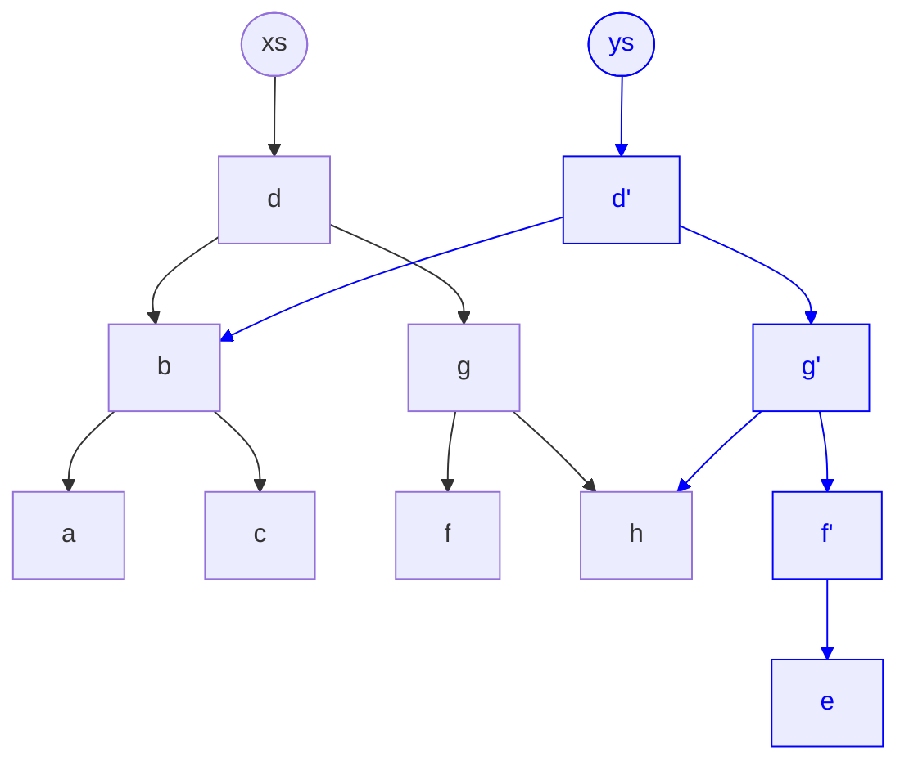

# Immutability, pure functions, referential stability

## Core ideas

- **Immutable update**: never mutate. Build a new container or object: `[...xs, x]`, `xs.map()`, `xs.filter()`, `xs.toSorted()`, `{ ...o, done: true }`.
- **Pure function**: output depends only on inputs. No argument mutation, no side effects. Same input, same output.
- **Referential stability**: change detection compares identity (`Object.is`), not content. Same reference means no change. New reference means change, even if the content is equal.
- **Rule**: content changed, new reference. Content unchanged, keep the same reference.

## Structural sharing

Updating one node copies only the path from the root to the change (blue). Everything else is shared by reference, so `===` checks show exactly which parts changed.



- Shared by both versions: `b`, `h`.
- Only in new version (`ys`): `d'`, `g'`, `f'`, `e`.
- Only in old version (`xs`): `d`, `g`, `f`, `a`, `c`.

## Immer

[Immer](https://immerjs.github.io/immer/) (about 3 KB gzipped) writes immutable updates as mutations on a draft.

- `produce(base, recipe)` returns `nextState`. `base` is never changed.
- The `draft` is a Proxy. Normal mutations (`push`, `splice`, `x.done = true`) are recorded and turned into copies.
- Structural sharing: unchanged branches keep the same reference (`next[0] === base[0]`).
- Changed branches get new references, so `===` change detection still works.
- Freezes produced data, and reports accidental mutations.
- Pure function, so it fits inside `signal.update()`.

```ts
import { produce } from 'immer';

this.tasksState.update((tasks) =>
  produce(tasks, (draft) => {
    const task = draft.find((t) => t.id === taskId);
    if (task) task.done = !task.done;
  }),
);
```

- Use Immer for deep or nested updates.
- Use plain spread for small, flat updates. It adds no dependency.

## Pitfalls

- `push()`, `splice()`, `sort()`, `reverse()`, `obj.x = ...` keep the same reference, so nothing is notified.
- `signal.set(sameRef)` is a no-op (default `equal` is `Object.is`).
- Prefer `update((xs) => [...xs, x])` over `set([...xs])`. Both notify, but `update` states the intent.
- Do not call functions in templates that return new arrays or objects. Each check creates a new reference (dev mode throws NG0100). Derive in `computed()` instead.

## Signals and `computed()` graph

- `signal.set(v)` notifies dependents only when `!Object.is(old, v)`. A custom `equal` option changes this.
- A `computed()` recomputes when a dependency notifies. Its dependents are notified only if its result changes by `Object.is`.
- Pure derivations make this reliable: same inputs produce the same result, so unchanged results stop propagation.
- In-place mutation is invisible to the graph. No dependency fires.
- Never write to signals inside `computed()`.

## Component graph (`input()`)

- An input signal notifies its reader only when the bound value's reference changes.
- A mutated object passed to a child is not re-rendered. The child reads `item().name`, which changed silently.
- `OnPush` is the default in Angular v22+. A child re-renders on input change only when the reference changes.
- Parent update: `items.update((xs) => xs.map((x) => (x.id === id ? { ...x, done: true } : x)))`. The child receives a new array and updates.
- A new reference with equal content causes an unnecessary child render. Keep derived data in the child's `computed()`.

## Pure pipes

- A pure pipe re-runs only when an argument changes by reference (primitives by value).
- A mutated array or object passed to a pipe leaves the output stale. The pipe does not re-run.
- A pipe must not mutate its input or cause side effects.
- `pure: false` re-runs on every change detection. Avoid it. Fix the data flow instead.

## RxJS `distinctUntilChanged()`

- Default comparator is `===`: reference for objects and arrays, value for primitives.
- Emits only when the reference changes. Re-emitting a mutated object with the same reference is filtered out.
- Immutable updates always produce a new reference, so every emission passes.
- For key-based equality, pass a comparator: `distinctUntilChanged((a, b) => a.id === b.id)`.
- `toSignal()` and `toObservable()` follow the same identity rules on the signal side.

## Checklist

- [ ] Changed content produces a new reference
- [ ] No mutating methods on state (`push`, `splice`, `sort`); use `toSorted()`
- [ ] Derived data lives in `computed()`, not in template calls
- [ ] Inputs and pipe arguments receive new references on change
- [ ] Custom comparator when equality is by key, not by reference
